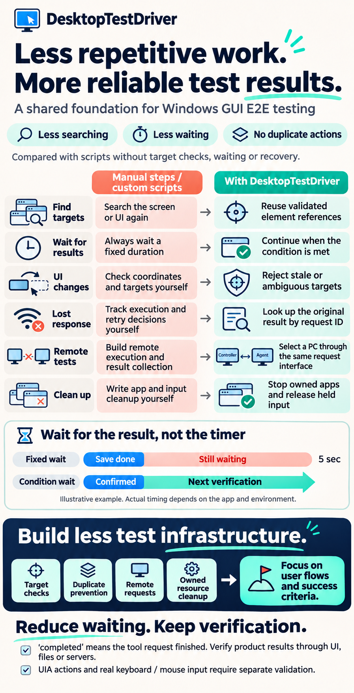

# DesktopTestDriver

> **Use only on trusted networks and PCs. The connection is not encrypted and has no authentication or permission checks.**

**DesktopTestDriver lets coding agents (Claude Code, Codex and others) and C# test code find, operate and read Windows GUIs by UI element instead of screen coordinates.** It drives buttons, inputs and lists through Windows UI Automation (UIA) by ID and name, and uses real keyboard and mouse input only when asked. The goal is to test GUIs faster and more reliably than computer use (screenshots plus coordinates).

[GUI test guide](docs/gui-test-guide.md) · [Command and request reference](docs/agent-usage.md) · [한국어 README](README_kr.md)

## At a glance

**Where it fits**

| Target | Examples |
|---|---|
| Windows desktop apps | Internal tools, launchers, admin programs and installers built with WinForms, WPF, WinUI or Win32 |
| Windows' own GUI | Settings (`ms-settings:`), Control Panel, `.msc` consoles, File Explorer windows |
| When | Checking an agent-built feature end to end on a real screen, repeating a flow as a regression test, testing several Windows PCs from one place |

**What it offers**

| Feature | Details |
|---|---|
| Element-level actions | Find targets by `automationId`, name or type (regex, contains, index) and read values as plain strings, independent of window position, resolution and DPI |
| Short observations | `inspect` returns a compact tree, one element per line, with references like `e12` and 12-character tokens |
| Condition waits | The tool waits until a value appears (up to 30 s; `anyOf` waits for success or an error dialog at once). A timeout returns `satisfied: false` |
| One round trip | Attach `expect` (result condition) and `observeAfter` (tree and new windows after the action) to an action and get them in the same response |
| Wrong targets refused | Stale references after a window or element changes are refused; several matches are refused with a candidate list |
| No duplicate execution | Mutations are recorded by request ID; sending the same ID again never runs them twice |
| Cleanup | Applications started by the session (and their children) are stopped, windows opened with `open` are closed, and keys and buttons the tool pressed are released |
| Replay without a model | Selectors from `generate-selector` can be saved in C# Client code and rerun without any LLM call |
| Tool integration | `Controller.exe --mcp` is an MCP server that Claude Code and other clients call directly |

**How it differs from computer use**

| | computer use | DesktopTestDriver |
|---|---|---|
| Finding targets | The model estimates coordinates from a screenshot | Look up by element ID or name |
| Reading values | The model reads text from the screen | Receive the string itself |
| Waiting | Repeated screenshots and judgement | Returns when the condition holds |
| Repeating | The model looks at the screen every time | Saved selectors run without a model |

This compares how the two work; it is not a measurement. Time and token comparisons for the same scenario have not been measured yet.

**Where it does not fit:** screens drawn directly with graphics (game clients, canvas UIs) have no UIA tree. Visual defects such as broken layout or colors are invisible to UIA, so a person or model must look at a capture. Only Windows is supported.



## Components

| Program | Where | Role |
|---|---|---|
| `Controller.exe` | The PC running the coding agent or test runner | Accepts requests, forwards them to an agent and collects results and images. Offers CLI, json-lines and MCP entry points |
| `Agent.exe` | The Windows PC with the application under test | Observes and operates the GUI in the logged-on user's desktop |

Both can run on the same PC. Remotely, run one agent per test PC and select it with `machineId`. The connection is plain TCP with no certificate, token or registration. The agent connects to the controller.



## Quick start

### 1. Build

On Windows 10/11 x64 with the .NET 10 SDK:

```powershell
.\build.ps1 -Package
```

Output goes to `bin/live_Release`. Target PCs need the .NET 10 Desktop Runtime x64.

### 2. Run

No configuration file is needed; command-line options are enough. The default port is 25001.

```powershell
# Same PC
.\Controller\Controller.exe --serve
.\Agent\Agent.exe                     # run it in the logged-on desktop

# Remote: the coding agent's PC
.\Controller.exe --serve --listen 0.0.0.0:25001
# Remote: the PC under test
.\Agent.exe --controller 192.168.0.10:25001 --machine test-pc
```

| Default | Value |
|---|---|
| Controller listen address | `127.0.0.1:25001` (change with `--listen` only to accept remote agents) |
| State folders | `%LOCALAPPDATA%\DesktopTestDriver\Controller`, `...\Agent` (change with `--state`) |
| Agent machineId | The computer name (change with `--machine`) |

For a resident setup use `scripts\manage.ps1 -Action Start|Stop|Status|Restart|InstallLogonTask`. To drive elevated tools (regedit, Services) run the agent elevated (`InstallLogonTask -Highest`).

```powershell
.\Controller.exe --status
.\Controller.exe --doctor          # actually checks the UIA worker, capture, input monitor, storage, elevation and monitors
```

### 3. Open a session and test

```powershell
.\Controller.exe --session-open --launch C:\Tools\MyApp.exe
```

This opens a session, starts the application, waits for its first window and returns its `windowId`. Attach to running applications with `--target-pid`, `--target-exe` or `--target-window-title`; open Settings or Control Panel inside the session with the `open` operation (`ms-settings:about`, `control.exe`). Add `--input` when real keyboard and mouse input is needed.

```text
- Window "간단 메모" [e1 t=167cdf32baf7]
  - Button #OpenButton "열기" [e3 t=fffaf470023a] patterns=Invoke
  - Button #SaveButton "저장" [e4 t=1d93122bc0be] patterns=Invoke
  - Edit #MemoText [e5 t=b2d40c2611bd] value="" patterns=Value,Scroll
```

See the [command and request reference](docs/agent-usage.md) for the request format, operations and error handling, and the [GUI test guide](docs/gui-test-guide.md) for a save-and-reopen test procedure.

### 4. Connect a coding agent

Add it to Claude Code as an MCP server. When no controller is running, the MCP server starts one itself.

```powershell
claude mcp add desktop-test-driver -- C:\DesktopTestDriver\Controller\Controller.exe --mcp
```

There are six tools: `gui_session`, `gui_window`, `gui_observe`, `gui_act`, `gui_wait`, `gui_capture`. A companion skill file is in [skills/desktop-test-driver/SKILL.md](skills/desktop-test-driver/SKILL.md). For an agent that only uses the CLI:

> The controller is `C:\DesktopTestDriver\Controller\Controller.exe`. Read the reference, then test typing, saving, closing and reopening in `C:\GuiTest\SimpleMemo.exe`. It passes only if the reopened text matches. Use UIA actions and condition waits; on failure keep the request ID and the observed evidence. Do not repeat an action whose result was `completionUnknown`. Close the session you opened and report confirmed and unconfirmed items separately.

## Verification

```powershell
.\build.ps1 -Configuration Debug   # source build
.\verify.ps1                       # Release build, package, contract/handler/TCP tests, package lifecycle check
.\verify.ps1 -UiTests              # the above plus real-desktop UIA tests (fixtures, Settings, Control Panel)
```

There are three test groups. Contract and handler tests use a fake desktop to check result classification and session state; TCP tests run a controller and an agent in one process to check timeouts, oversized responses, reconnects and capture delivery; UI tests drive WinForms and WPF fixtures, Settings and Control Panel for real. Real keyboard and mouse input and a two-PC setup are not part of automated verification. UIA does not support every application or control, and captures of minimized windows are refused.

`Driver.Tests.exe --bench FILE` times the driver's own work (find, set value, typing, capture, CLI and pipe round trips) against a fake provider.

<details>
<summary>Repository layout</summary>

| Path | Contents |
|---|---|
| `src/Controller/`, `src/Agent/` | Executables (the controller includes the CLI, json-lines and MCP entry points) |
| `src/Client/` | C# client API |
| `src/Core/`, `src/Contracts/` | Transport, UIA, input and cleanup, plus request/response contracts |
| `fixtures/`, `tests/` | Test applications (SimpleMemo, FormsWorkbench, WpfWorkbench, InputWindow) and automated checks |
| `schemas/`, `examples/standalone/` | DTO schemas (generated with `--export-schemas`) and a standalone example |
| `scripts/`, `docs/`, `skills/` | Start/stop script, documentation, Claude Code skill |

</details>

## License

[MIT License](LICENSE).
