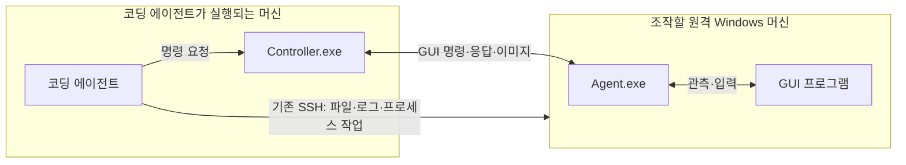

# DesktopTestDriver

> **DesktopTestDriver는 사람이 아닌 코딩 에이전트를 위한 도구다. 코딩 에이전트가 원격 Windows 머신의 GUI 프로그램을 관측하고 조작하는 데 사용한다.**

DesktopTestDriver는 **코딩 에이전트와 같은 머신에서 실행하는 Controller.exe**와 **조작할 원격 Windows 머신에서 실행하는 Agent.exe**로 구성된다. 코딩 에이전트는 Controller에 GUI 명령을 요청하고, Controller는 Agent에 전달해 실행 결과와 관측값을 돌려준다. 기존 SSH는 원격 파일·프로세스·서비스·로그 작업에 사용한다.

**새 구조는 시나리오를 사용하지 않는다.** 코딩 에이전트가 계획을 세우고 필요한 GUI 명령을 하나씩 요청한다. 도구가 반환한 관측값과 화면을 보고 다음 행동과 제품의 성공·실패를 판단하는 주체도 코딩 에이전트다.

이 README는 앞으로 개발할 구조와 사용 방향을 설명한다. 기존 GUI 코드를 이 구조로 바꾸는 단계이며, 아래 요청 명령과 응답 형식은 아직 구현 전이다.

**도구를 호출할 코딩 에이전트에게는 [사용 규약](docs/agent-usage.md)을 전달한다.** 이 문서에 명령·필드·응답·오류 후 행동과 처음부터 한 번 조작하는 예가 있다. 구현자는 [설계·구현 계획](docs/agent-driven-desktop-control.md) 맨 앞의 Controller·Agent 명칭 통일·미사용 항목 삭제 계획부터 따른다. 사용 규약도 현재 배포본에서 실행 가능한 안내가 아니라 구현할 목표 계약이다.

## 역할

| 작업 | 담당 |
|---|---|
| 조작 계획·순서·대기·재시도 | 코딩 에이전트 |
| 여러 원격 머신의 작업 조율 | 코딩 에이전트 |
| 파일·프로세스·서비스·로그 관리 | 코딩 에이전트가 기존 SSH 사용 |
| GUI 앱 실행·창 조회·화면 캡처·입력 | DesktopTestDriver |
| 제품 기능의 성공·실패 판정 | 코딩 에이전트 |
| 제품 연결 종료·설정 복원 계획 | 코딩 에이전트 |
| 도구가 누른 키·마우스 버튼의 해제 | DesktopTestDriver |

DesktopTestDriver의 실행 결과는 요청한 GUI 명령의 수행 여부와 관측값이다. 클릭 입력 전달 완료가 제품 연결 성공을 뜻하지는 않는다.

## 동작 구조

**Controller.exe와 Agent.exe 두 프로그램을 만든다. 두 프로그램을 서로 다른 역할과 머신에 배치한다.**

| 프로그램 | 설치·실행 위치 | 역할 | 소스 프로젝트 |
|---|---|---|---|
| **Controller.exe** | **코딩 에이전트와 같은 머신** | 코딩 에이전트의 요청을 받아 원격 Agent에 전달하고 JSON 응답·관측값·이미지를 반환 | `src/Controller/Controller.csproj` |
| **Agent.exe** | **조작할 원격 Windows 머신** | 로그인된 사용자 데스크톱에서 실제 GUI 관측·입력과 제어 세션을 관리 | `src/Agent/Agent.csproj` |



**Controller를 없애거나 Agent 하나로 합치는 구조가 아니다.** Controller와 Agent 사이의 기존 통신 경로를 재사용한다. Controller는 여러 Agent 연결을 관리하고 GUI 요청을 전달하지만, 시나리오를 실행하거나 제품의 성공·실패를 판정하지 않는다.

Agent는 원격 머신의 로그인된 데스크톱에서 실행한다. 코딩 에이전트가 이미 사용하는 SSH 연결과 GUI 명령 전달 경로는 구분한다. 별도 SSH 클라이언트를 새로 만들지 않는다.

현재 소스의 Server·Client 이름은 Controller·Agent 이름으로 프로젝트·디렉터리·코드·패키지까지 함께 변경한다. Core와 Contracts는 공통 라이브러리다. 필요한 기동·독립 입력 해제 기능은 유지하되 별도 Broker·Watchdog 제품 이름은 정리한다.

## 에이전트의 사용 흐름

1. 코딩 에이전트와 같은 머신에서 Controller를 사용한다. 원격 머신에는 Agent가 기동되어 있어야 한다.
2. Controller로 연결된 Agent와 지원 범위를 조회하고, 조작할 machineId를 지정해 제어 세션을 연다.
3. 창·UI 정보를 조회하거나 화면을 캡처해 조작 대상을 찾는다.
4. 클릭·문자 입력 등 필요한 GUI 명령을 요청한다.
5. 반환된 정보·이미지와 SSH로 확인한 로그를 보고 다음 행동을 정한다.
6. 작업을 마치면 필요한 앱 종료·제품 복원을 요청하고 제어 세션을 닫는다.

제어 세션은 여러 명령이 같은 데스크톱을 이어서 조작하기 위한 문맥이다. 시험 계획이나 기대 결과를 담지 않는다. Controller 요청 프로세스가 종료돼도 Agent와 세션은 유지되며, 에이전트가 화면을 분석하는 동안 계속해서 명령을 보낼 필요는 없다.

## 요청과 응답

다음은 구현할 요청 방식의 예다. 코딩 에이전트가 자신이 실행되는 머신에 요청 파일을 작성하고 그 머신의 Controller.exe를 실행한다. 세션·창·요소 식별값은 실제 관측 결과에서 얻는다. 변경 입력 전에는 별도의 focus 요청으로 대상 창을 활성화한다.

```powershell
.\Controller.exe --request .\click.json
```

`click.json`에는 한 번의 GUI 명령만 넣는다.

```json
{
  "apiVersion": 1,
  "requestId": "click-001",
  "controlSessionId": "control-001",
  "operation": "click",
  "arguments": {
    "windowId": "win-007",
    "automationId": "ConnectButton"
  }
}
```

이 파일은 명령 메시지다. 단계 배열·분기·기대 결과를 담는 시나리오가 아니다. 명령을 받은 도구는 실행 결과를 반환한다.

```json
{
  "apiVersion": 1,
  "requestId": "click-001",
  "controlSessionId": "control-001",
  "operation": "click",
  "machineId": "target-01",
  "status": "completed",
  "data": { "windowId": "win-007", "inputEventsSent": 2 },
  "error": null,
  "observedAt": "2026-10-20T06:30:00Z"
}
```

`completed`는 클릭 입력 전달을 마쳤다는 뜻이다. 에이전트는 이후 화면·UI 정보·로그를 보고 제품의 동작을 판단한다. Agent가 캡처한 이미지는 Controller가 수집해 코딩 에이전트가 실행되는 머신에 저장한다. 에이전트는 반환된 경로의 실제 이미지를 열어 본다.

## 개발할 GUI 기능

| 기능 | 제공할 동작 |
|---|---|
| 상태 조회 | GUI 실행부·데스크톱 세션·지원 기능 확인 |
| 창·UI 관측 | 창 탐색, 요소 식별, 읽을 수 있는 UI 값 반환 |
| 화면 캡처 | 창·영역 이미지와 좌표·시각 정보 반환 |
| 앱·창 조작 | GUI 앱 실행, 포커스 변경, 명시적 종료 |
| 입력 | 클릭·이동·드래그·휠·문자·키 조합 |
| 입력 해제 | 도구가 누른 키·버튼 해제 |
| 요청 기록 | 응답 유실 시 실행 결과 조회와 중복 실행 방지 |

명령 오류가 나도 가능한 관측을 유지해 에이전트가 다시 판단할 수 있게 한다. 입력 해제와 앱 종료를 분리하고, 제어 세션을 닫았다는 이유만으로 제품 앱을 무조건 종료하지 않는다.

## 개발 상태와 문서

현재 저장소에는 Server·Client 프로젝트 이름과 시나리오 실행 코드가 남아 있다. Controller·Agent 명칭을 통일하고 두 프로그램의 통신·GUI 코드를 재사용하면서, 시나리오 파서·실행기·제품 판정기를 제거한다. 시나리오를 선택적 사용자 기능으로 유지하지 않는다.

이 README의 새 명령을 현재 실행 가능한 사용법으로 취급하지 않는다. 실제 구현·데스크톱 연동 확인이 완료되면 설치와 사용 명령을 갱신한다.

사용 문서의 예시가 실제 구현과 일치하고, 기존 코드를 모르는 호출자가 그 문서만 보고 같은 머신의 Controller로 원격 Agent의 관측·조작·이미지 확인·오류 후 대응을 수행할 수 있어야 사용 가능한 배포본으로 표시한다.
