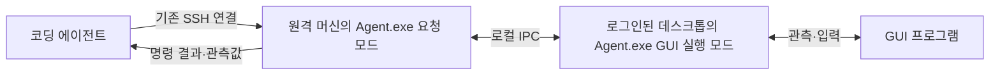

# DesktopTestDriver

> **DesktopTestDriver는 사람이 아닌 코딩 에이전트를 위한 도구다. 코딩 에이전트가 원격 Windows 머신의 GUI 프로그램을 관측하고 조작하는 데 사용한다.**

코딩 에이전트는 이미 SSH로 원격 머신의 파일·프로세스·서비스·로그를 다룬다. DesktopTestDriver는 로그인된 데스크톱에서 수행해야 하는 앱 실행, 창·UI 정보 조회, 캡처, 키보드·마우스 조작을 제공한다.

**무엇을 어떤 순서로 조작하고 제품의 동작이 올바른지 판단하는 책임은 코딩 에이전트에 있다.** 도구가 클릭 입력을 전달했다는 사실은 제품 기능이 성공했다는 뜻이 아니다. 전용 시나리오 파일 없이 개별 명령을 요청하는 방식을 기본 사용 방향으로 삼는다.

## 사용 흐름과 현재 상태

에이전트는 **계획 → GUI 관측 → 명령 요청 → 응답·화면 확인 → 다음 행동 결정**을 반복한다. 여러 PC의 작업 순서, 대기·재시도, 제품 결과 판정과 복원 계획은 에이전트 또는 사용하는 프로젝트가 담당한다. 일반 셸 명령과 파일 전송은 기존 SSH를 사용한다.

목표 호출 구조는 다음과 같다. **새 SSH 프로그램을 만드는 것이 아니라, 기존 Agent.exe에 GUI 요청을 전달하는 명령을 추가한다. 이 직접 요청 경로는 아직 구현되지 않았다.**



| 구분 | 현재 사용할 수 있는 코드 경로 | 개발 방향 |
|---|---|---|
| 연결 | 조작 PC의 Controller와 대상 PC의 Agent가 TCP로 연결 | SSH에서 실행한 Agent.exe 요청 모드가 같은 머신의 GUI 실행부에 로컬 IPC로 전달 |
| 명령 요청 | `begin` → `request` 반복 → `end` | 간단한 제어 세션과 GUI 명령 |
| 설정 | 현재 계약상 run JSON 필요 | 설치 설정과 제어 세션 옵션으로 단순화 |
| 시나리오·제품 판정 | 기존 시나리오 실행 코드도 포함 | GUI 기본 경로에서 분리하고 호출자에게 맡김 |
| 오류·종료 | 명령 실패·작업 종료 시 소유 앱도 종료될 수 있음 | 재관측을 허용하고 입력 해제와 앱 종료를 분리 |

현재의 창 조회·입력·캡처 코드를 재사용해 방향을 전환한다. 목적·책임 구분, 구체적인 요청 예시, 변경할 코드와 완료 기준을 [원격 GUI 조작 설계와 구현 계획](docs/agent-driven-desktop-control.md)에 모았다. 요청 파일은 한 번의 GUI 명령을 담으며, 시험 순서·기대 결과를 담는 시나리오가 아니다.

아래는 **현재 Controller/Agent 코드로 시나리오 없이 개별 명령을 보내는 호환 경로**다. 계획 중인 `Agent.exe --request`·`--session-open` 등의 명령은 아직 사용할 수 없다. 현재 직접 명령 경로도 실제 데스크톱 연동 확인이 남아 있다.

## 현재 호환 경로의 실행 파일 준비

현재 프로젝트는 Windows 10 2004 이상 또는 Windows 11 x64와 .NET 10 Desktop Runtime을 사용한다. 소스 빌드에는 .NET 10 SDK가 필요하다. 실행 파일을 받았다면 빌드·게시를 건너뛰고 게시 폴더 전체를 복사한다.

저장소 루트에서 다음을 실행한다.

```powershell
dotnet build DesktopTestDriver.slnx -c Release
dotnet publish src/Server/Server.csproj -c Release -r win-x64 --self-contained false -o dist/Server
dotnet publish src/Client/Client.csproj -c Release -r win-x64 --self-contained false -o dist/Client
dotnet publish src/Client.Watchdog/Client.Watchdog.csproj -c Release -r win-x64 --self-contained false -o dist/Client.Watchdog
```

프로젝트 폴더 이름은 Server/Client지만 생성되는 실행 파일은 Controller.exe/Agent.exe다. EXE만 복사하지 않고 DLL·설정 파일을 포함한 폴더 전체를 복사한다.

| 복사할 곳 | 게시 폴더 | 복사 후 예 |
|---|---|---|
| 조작 PC | `dist/Server` | `C:\DesktopTestDriver\Server\Controller.exe` |
| 대상 PC | `dist/Client` | `C:\DesktopTestDriver\Client\Agent.exe` |
| 대상 PC | `dist/Client.Watchdog` | `C:\DesktopTestDriver\Client.Watchdog\Client.Watchdog.exe` |

대상 PC의 Client와 Client.Watchdog은 같은 상위 폴더 아래에 둔다. Watchdog은 도구 내부의 생존 감시·입력 해제·현재 정리 동작을 담당하며 별도로 실행하지 않는다.

## 현재 호환 경로의 연결 설정

예시에서 조작 PC 주소는 `192.168.0.61`, 대상 머신 ID는 `notebook-74`다. 실제 환경 값으로 바꾼다.

조작 PC의 Controller.exe 옆 `Controller.json`:

```json
{
  "host": "192.168.0.61",
  "port": 25071,
  "stateRoot": "state"
}
```

대상 PC의 Agent.exe 옆 `Agent.json`:

```json
{
  "machineId": "notebook-74",
  "host": "192.168.0.61",
  "port": 25071,
  "targetSession": 0,
  "stateRoot": "state"
}
```

두 파일의 host는 모두 조작 PC 주소다. Agent가 Controller로 접속하며 TCP 포트는 25001~25199에서 지정한다. 현재 경로에서는 해당 수신 연결이 가능해야 한다. 일반 TCP를 사용하며 TLS·연결 인증은 제공하지 않는다.

Agent.json의 `targetSession: 0`은 Agent를 실행한 현재 세션을 사용한다는 뜻이다. **SSH에서 Agent를 바로 실행하면 로그인된 GUI 세션이 자동 선택되는 것은 아니다.** 현재는 로그인된 일반 사용자 바탕화면에서 실행하거나, 기존 Broker의 대화형 세션 기동 경로를 사용해야 한다.

상대 stateRoot는 각 EXE 폴더 기준이다. 없으면 전용 상태 폴더를 생성한다. 현재 지원 범위는 활성 콘솔의 일반 사용자 `Default` 바탕화면이며, 관리자 UI·UAC·잠금 화면과 모든 RDP 환경을 지원하는 것은 아니다.

조작 PC에서 Controller.exe를 인자 없이 실행해 유지하고, 대상 PC에서 Agent.exe를 실행한다. 조작 PC의 별도 터미널에서 Server 폴더로 이동해 조회한다.

```powershell
.\Controller.exe list
```

응답의 `data` 배열에서 `machineId`, 실제 `session`, `activeRun`, `cleanupBlocked`를 확인한다. 작업 전에는 activeRun이 null이고 cleanupBlocked가 false여야 한다. 목록이 비면 Controller·Agent 기동과 host·port·수신 연결을 확인한다.

여기서 Agent.exe는 원격 GUI 실행 프로세스 이름이며, 사용자인 코딩 에이전트와 구분한다. 각 대상 머신은 상시 Agent 하나와 작업 중 실행부·Watchdog을 사용한다.

## 시나리오 없이 현재 명령 보내기

현재 호환 경로에는 작업 설정 파일 하나와 요청할 명령 JSON이 필요하다. 시나리오·bindings 파일은 필요 없다. 다음 예는 입력 없이 세션과 데스크톱 상태를 조회한다.

### 작업 설정

조작 PC의 `C:\MyProject\desktop\target.run.json`에 다음을 둔다.

```json
{
  "protocolVersion": 2,
  "runId": "gui-001",
  "machineId": "notebook-74",
  "role": "observer",
  "targetSession": 1,
  "expectedDesktop": "Default",
  "expiresAt": "REPLACE_WITH_FUTURE_ISO8601",
  "maxSeconds": 600,
  "recovery": "R0",
  "allowInput": false,
  "windows": [],
  "allowedKeys": [],
  "delegation": {
    "owner": "TEST-PC\\tester",
    "requester": "coding-agent",
    "keyId": "lab-owner",
    "scenarios": [],
    "actions": ["inspect", "heartbeat"],
    "productPermissions": [],
    "evidence": { "retainHours": 24, "maxBytes": 67108864, "images": false },
    "signature": ""
  }
}
```

설정할 값은 다음과 같다.

| 필드 | 지정할 값 |
|---|---|
| `runId` | 사용하지 않은 새 작업 ID |
| `machineId` | list에서 확인한 대상 머신 ID |
| `targetSession` | list의 실제 session. run 설정에서는 0을 쓰지 않는다 |
| `expiresAt` | 시간대가 포함된 미래 ISO 8601 시각 |
| `delegation.owner` | 대상 PC의 실행 사용자. SSH의 whoami 등으로 확인한다 |

PowerShell에서 다음으로 15분 뒤 UTC 시각을 얻어 expiresAt에 넣을 수 있다.

```powershell
[DateTimeOffset]::UtcNow.AddMinutes(15).ToString('o')
```

이 예의 최대 작업 시간은 600초다. 현재 상시 Controller 경로는 개발용 위임 범위 검사를 사용하므로 서명 키를 만들 필요가 없고 signature는 빈 문자열이다. `scenarios: []`와 role 등은 현행 계약 호환용이며, 시나리오 파일을 작성하라는 뜻이 아니다. 이 설정 부담은 새 구조에서 단순화할 개발 항목이다.

### 관측 요청과 응답

`C:\MyProject\desktop\inspect.json`:

```json
{ "name": "inspect" }
```

조작 PC의 Server 폴더에서 실행한다.

```powershell
.\Controller.exe begin notebook-74 C:\MyProject\desktop\target.run.json
.\Controller.exe request notebook-74 C:\MyProject\desktop\inspect.json
```

`request`는 JSON 응답을 출력하고 종료한다. **개별 request CLI의 정상 종료로 작업이 끝나지는 않는다.** Controller가 내부 heartbeat를 유지하며 같은 작업에 후속 request를 보낼 수 있다. 현재 작업은 maxSeconds·expiresAt 안에서만 유지된다.

| 응답 필드 | 의미 |
|---|---|
| `ok` | Controller 요청 처리 여부 |
| `data.accepted`, `data.executed` | 명령 수락·실행 여부 |
| `data.errorCode` | 명령 실행 오류. 정상은 `None` |
| `data.evidence.observation` | inspect로 얻은 세션·바탕화면·모니터·창 정보 |
| `data.evidence.frames` | 관측한 창별 프레임·실제 창 식별값 |
| `data.verified` | 기존 명령 내부의 확인 값. 제품 기능 성공 판정이 아님 |

외부 요청의 ok가 true여도 내부 명령 오류가 있을 수 있다. accepted·executed·errorCode와 실제 관측값을 함께 읽는다. 에이전트가 관측 결과로 다음 동작을 결정하고 필요한 request를 보낸다.

이 예는 windows가 비어 있어 앱 창을 반환하지 않는다. 현재 코드에서 앱을 조회·조작하려면 run 설정의 windows에 실제 앱 경로·SHA-256·창 제목을 등록해야 한다. 사전 등록 없이 처음 보는 창을 탐색하는 기능은 개발 항목이다.

### 현재 GUI 명령과 제약

| 기능 | 현재 명령 | 필요한 정보 |
|---|---|---|
| 창·세션 조회 | `inspect` | run에 등록한 창 범위 |
| UI 정보 읽기 | `controls` | 관측에서 얻은 `expectedWindow` |
| 포커스·창 이미지 | `focus`, `snapshot` | `expectedWindow`, `frameId` |
| 요소 클릭 | `click-control` | 실제 창 title 또는 hwnd, `automationId` |
| 창 좌표 클릭·이동 | `click-window`, `move-window` | 실제 창 title 또는 hwnd, 창 내부 좌표 |
| 문자 입력 | `type-window` | 실제 창 title 또는 hwnd, text |
| 낮은 수준 입력 | `click`, `drag`, `wheel`, `text`, `chord`, `key-down`, `key-up` | 최신 프레임·창 식별과 입력값 |
| 도구 입력 해제 | `release-all` | 현재 작업 |

예를 들어 입력 설정을 갖춘 작업에서 다음 내용을 명령 파일로 보내면 해당 요소를 클릭한다. 제목과 AutomationId는 실제 관측값으로 대체한다. `click-control`은 내부에서 창을 다시 조회하고 필요하면 포커스를 옮긴다.

```json
{
  "name": "click-control",
  "title": "<관측한 창 제목>",
  "automationId": "<관측한 버튼 AutomationId>"
}
```

위 R0 예제는 입력을 허용하지 않는다. 현재 입력·앱 실행에는 allowInput, 등록한 앱·창·명령·키 범위와 R1 및 RecoveryEvidence 필드가 필요하다. 이것은 현행 검증기의 제약이며 새 설계의 필수 준비 절차로 삼지 않는다. 자세한 현재 필드는 [작업 설정 템플릿](inventory/run.template.json)을 참고한다. 필요한 설정이 바뀌면 현재 작업을 닫고 새 runId로 연다.

이미지는 `snapshot`으로 얻은 프레임 ID를 이용해 현재 제공되는 저장 명령으로 조작 PC에 가져올 수 있다. 아래 ROOT는 Controller의 실제 stateRoot 경로다.

```text
Controller.exe agent-save-frame ROOT MACHINE FRAME_ID OUTPUT_PNG
```

캡처·이미지 읽기에는 현재 evidence.images와 snapshot/read-frame 등의 명령 허용이 필요하다. 현재 snapshot은 전경 창을 요구하므로 관측만으로 모든 창을 캡처할 수 있는 것은 아니다. 새 구조에서는 원격 Agent.exe가 캡처 파일을 만들고 에이전트가 기존 SSH 파일 전송으로 가져오는 흐름을 제공할 계획이다.

## 현재 작업의 종료와 오류 처리

필요한 개별 요청을 마치면 조작 PC에서 작업을 닫는다.

```powershell
.\Controller.exe end notebook-74
```

현재 end는 입력 해제와 소유 앱 종료 등 기존 정리를 수행하며 상시 Agent는 유지한다. 응답의 clean·normalDesktop과 runId를 확인한다. **현재는 일반 명령 오류·단절·만료로도 작업과 소유 앱이 정리될 수 있다.** 따라서 제품 앱을 유지한 채 오류를 재관측하려면 D06·D09 구현이 필요하다.

| 원하는 동작 | 현재 명령 |
|---|---|
| 연결된 Agent 조회 | `Controller.exe list` |
| 작업 종료·정리 | `Controller.exe end MACHINE` |
| 대상 Agent 종료 | `Controller.exe exit MACHINE` |
| 저장된 작업 결과 조회 | `Controller.exe result RUN_ID` |
| Controller 종료 | `Controller.exe shutdown` |

현재 result는 내부 실행·정리 기록 조회이며 제품 시험의 성공 판정이 아니다. 응답 유실 시 입력을 자동으로 반복하지 말고 작업 상태와 화면을 확인한다. 호출자가 지정한 요청 ID로 실행 결과를 조회하는 계약은 개발 항목이다.

## 현재 오류를 해석하는 방법

| 증상·오류 | 확인할 내용 |
|---|---|
| list 실패·빈 목록 | Controller·Agent 기동, 설정, 포트 연결 |
| `Expired` | expiresAt·maxSeconds와 현재 시각 |
| `ReservationConflict` | 진행 중 작업, 중복 Agent, 사용한 runId, 실제 세션, 정리 차단 상태 |
| `RecoveryRequired` | 현재 입력 검증기가 요구하는 설정·복구 증거 필드 |
| `WindowChanged`, `StaleFrame` | 대상 창·배치 변경과 프레임 유효 시간. 재관측 필요 |
| `ObservationUnavailable` | UI 정보·캡처·결과 조회가 가능한지 |
| `AuthenticationFailed` | 상태 폴더·IPC 접근 계정과 권한 |
| `CleanupIncomplete` | 도구 입력·소유 자원의 실제 정리 상태 |

현재 처리 경로에서는 오류 뒤 작업이 이미 닫혔을 수 있다. 상태를 확인한 뒤 다음 요청 또는 새 작업 여부를 결정한다. 이 동작을 에이전트 친화적인 요청 오류·재관측으로 바꾸는 내용은 개발 문서에 있다.

## 기존 기능과 문서의 위치

기존 `scenario-check`·`scenario-run`과 제품 Pass/Fail 판정 코드는 남아 있지만 기본 사용 방향에서 분리한다. 전용 시나리오를 새로 작성하는 것을 도구 사용의 선행 작업으로 안내하지 않는다. 기존 시나리오 사용법은 호환 기능을 확인할 때만 참고한다.

SSH·Python·Broker를 이용한 기존 배포·기동 코드도 있다. 현재 Controller 경로의 GUI 명령 전송은 여전히 TCP다. 기존 Agent.exe에 추가할 요청 모드와 GUI 실행 모드의 연결은 별도 구현 작업이다.

현재 지원 코드는 빌드 확인 이력이 있지만 실제 데스크톱 입력·캡처·다중 머신·장애 동작 확인은 남아 있다. 이 문서의 예시는 제품 E2E 시험을 통과했다는 기록이 아니다. 이번 정리는 문서 변경이며 실행 코드의 동작을 바꾸지 않는다.

| 문서 | 용도 |
|---|---|
| [원격 GUI 조작 설계와 구현 계획](docs/agent-driven-desktop-control.md) | 사용 목적·책임 구분·요청 예시·변경 코드·완료 기준 |
| [기존 Controller / Agent 계약](docs/controller.md) | 현재 호환 경로와 기존 통신 구조 확인 |
| [기존 시나리오 작성 규약](docs/scenario-authoring.md) | 남아 있는 시나리오 기능의 문법 참고 |
