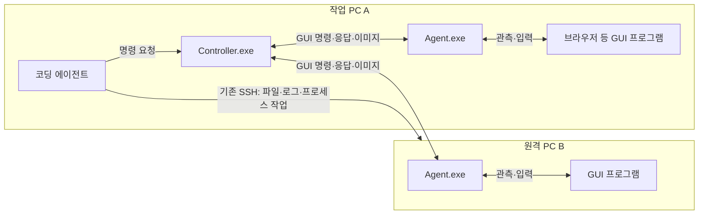

# DesktopTestDriver

> **DesktopTestDriver는 코딩 에이전트가 작업 PC 자체와 원격 Windows PC의 GUI 프로그램을 관측하고 조작하는 도구다.**

DesktopTestDriver는 **코딩 에이전트와 같은 PC에서 실행하는 Controller.exe**와 **관측하거나 조작할 각 PC에서 실행하는 Agent.exe**로 구성된다. 작업 PC 자체를 조작할 때도 같은 PC에 Agent를 실행한다. 코딩 에이전트는 Controller에 GUI 명령을 요청하고, Controller는 선택한 Agent에 전달해 실행 결과와 관측값을 돌려준다. 원격 파일·프로세스·서비스·로그 작업에는 기존 SSH를 사용하며, 같은 PC의 파일 작업에는 일반 로컬 명령을 사용한다.

**새 구조는 시나리오를 사용하지 않는다.** 코딩 에이전트가 계획을 세우고 필요한 GUI 명령을 하나씩 요청한다. 도구가 반환한 관측값과 화면을 보고 다음 행동과 제품의 성공·실패를 판단하는 주체도 코딩 에이전트다.

API 1의 Controller·Agent와 아래 GUI 작업을 구현했다. 로컬 계약·통신·프로세스 검증과 실제 화면·두 PC 검증은 [구현 계획의 체크 상태와 증거](docs_working/GUI-사용매뉴얼-기반-상세구현계획-13.md)로 구분한다.

Windows 11의 실제 메모 저장·재열기, 입력 확인 창, 입력 중 세션 종료, 본체·감시 장애 후 해제와 두 실제 PC의 동시 조작/관측을 확인했다. 두 PC 검사의 현장 입력자는 별도 조작 세션으로 모의했다. RemoteAssist 실제 시험은 사용자 지시로 제외했으며 Viewer 역할의 A 입력·B 관측 도구 계약만 모의 검증했다. 관리자 창·잠금·RDP·HDR 및 RemoteAssist 제품 동작의 통과를 뜻하지 않는다.

**사용 방식은 [간단한 GUI 테스트 매뉴얼](docs_working/간단한-GUI-테스트-사용매뉴얼-11.md)과 [RemoteAssist E2E 테스트 매뉴얼](docs_working/RemoteAssist-E2E-테스트-사용매뉴얼-12.md)을 기준으로 한다.** 두 문서는 독립 도구와 선택 제품 시험의 절차를 설명한다. 개발자는 [상세 구현 계획](docs_working/GUI-사용매뉴얼-기반-상세구현계획-13.md)의 태스크 순서와 완료 기준을 따른다. 실제 명령·필드·응답·오류 후 행동은 [사용 규약](docs/agent-usage.md)을 따른다. 설치와 인증서 등록도 사용 규약에서 안내한다.

## 구현 기능 목록

아래는 API 1의 구현된 작업이다. 실제 Windows 및 두 PC에서 확인한 범위는 계획의 증거를 따른다. 코딩 에이전트가 Controller에 작업을 하나씩 요청하면, 대상 PC의 Agent가 수행하고 결과를 돌려준다. 대상은 Agent가 실행 중인 Windows PC이며, 작업 PC 자체와 원격 PC를 모두 포함한다.

| 기능 | 할 수 있는 일 |
|---|---|
| 연결된 PC 확인 | 연결된 Agent 목록을 읽고 조작할 PC를 선택한다 |
| PC 상태·지원 기능 확인 | 사용자가 로그인한 바탕화면과 조작 가능 상태, 지원하는 작업과 제한을 확인한다 |
| 여러 PC 구분 | PC별로 연결을 열어 명령을 보내고, 어느 PC에서 나온 결과인지 구분한다 |
| 조작 연결 관리 | 같은 PC에 여러 명령을 이어서 보내는 제어 세션을 열고, 상태 조회·종료·유휴 시간 만료를 처리한다 |
| 관측 전용 연결 | 클릭·입력·창 활성화 없이 창·버튼 정보와 화면만 읽는다 |
| GUI 프로그램 실행 | 대상 PC의 실행 파일 경로와 실행 인자를 지정해 프로그램을 연다 |
| 창 찾기 | 열린 창의 제목·실행 파일·프로그램 번호·위치를 읽어 대상 창을 찾는다 |
| 버튼·입력칸 찾기 | 창 안의 버튼·입력칸·선택 항목을 찾고 이름·위치·사용 가능 여부를 읽는다 |
| 표시 값 읽기 | 프로그램이 읽기를 허용하는 입력칸의 문자와 표시 값을 가져온다. 암호 등 읽을 수 없는 값은 그 이유를 알린다 |
| 창 화면 캡처 | 대상 창의 화면을 이미지로 저장하고 크기·좌표·촬영 시각을 반환한다 |
| 캡처 이미지 전달 | 대상 PC에서 캡처한 이미지를 Controller가 실행되는 작업 PC에 저장하고 파일 경로를 반환한다 |
| 창 활성화 | 조작할 창을 앞에 띄우고 키보드 입력을 받을 창으로 지정한다 |
| 마우스 클릭 | 조회한 버튼·입력칸 또는 캡처에서 확인한 좌표를 왼쪽·오른쪽·가운데 버튼으로 클릭한다 |
| 마우스 이동·끌기·스크롤 | 포인터를 옮기고, 버튼을 누른 채 끌고, 휠로 화면을 스크롤한다 |
| 문자 입력 | 선택한 입력칸에 한글·영문 등의 문자열을 입력한다 |
| 키보드 조작 | Enter·Tab·방향키·기능키 등을 누르고 떼거나, Ctrl+A 같은 키 조합을 보낸다 |
| 입력 해제 | 도구가 누른 키와 마우스 버튼을 해제한다. 누름 시간 제한·세션 종료·장애 시에는 독립 감시가 해제를 시도하고 확인한 결과를 남긴다 |
| 창 닫기·프로그램 종료 | 창 닫기를 요청하거나, 해당 제어 세션에서 도구가 실행한 프로그램을 지정해 종료한다 |
| 실행한 앱의 유지 여부 선택 | 제어 세션을 닫을 때 실행한 앱을 유지할지 함께 종료할지 지정한다 |
| 요청 결과 반환 | 요청한 작업의 완료·실패·거부·실행 여부 불명확 상태와 확인한 정보를 반환한다 |
| 이전 요청 결과 조회 | 응답을 받지 못한 요청의 실행 상태와 결과를 다시 조회한다 |
| 같은 요청의 중복 실행 방지 | 기록 보관 기간 안에 같은 요청 번호와 내용이 다시 오면 저장된 결과를 돌려주어 입력이 중복되지 않게 한다 |
| 잘못된 대상 입력 차단 | 창이 바뀌었거나 캡처가 오래됐거나 대상 버튼이 모호하면 입력 전에 거부하고 이유를 반환한다 |

이 기능을 조합하면 메모 입력·저장·다시 열기, 설정 화면 조작, 브라우저에서 실행하는 제품의 화면·입력 테스트 등을 진행할 수 있다. 시험 순서와 성공·실패 판단은 코딩 에이전트가 맡는다. 파일 전송·로그 수집·서비스 관리는 코딩 에이전트가 로컬 명령과 기존 SSH로 수행한다.

## 역할

| 작업 | 담당 |
|---|---|
| 조작 계획·순서·대기·재시도 | 코딩 에이전트 |
| 작업 PC와 원격 PC의 작업 조율 | 코딩 에이전트 |
| 파일·프로세스·서비스·로그 관리 | 코딩 에이전트가 로컬 명령과 기존 SSH 사용 |
| GUI 앱 실행·창 조회·화면 캡처·입력 | DesktopTestDriver |
| 제품 기능의 성공·실패 판정 | 코딩 에이전트 |
| 제품 연결 종료·설정 복원 계획 | 코딩 에이전트 |
| 도구가 누른 키·마우스 버튼의 해제 | DesktopTestDriver |

DesktopTestDriver의 실행 결과는 요청한 GUI 명령의 수행 여부와 관측값이다. 클릭 입력 전달 완료가 제품 연결 성공을 뜻하지는 않는다.

## 동작 구조

**Controller.exe와 Agent.exe는 서로 다른 역할의 프로그램이다. 같은 PC에도 함께 실행할 수 있다.**

| 프로그램 | 설치·실행 위치 | 역할 | 소스 프로젝트 |
|---|---|---|---|
| **Controller.exe** | **코딩 에이전트와 같은 PC** | 코딩 에이전트의 요청을 받아 같은 PC 또는 원격 PC의 Agent에 전달하고 결과·이미지를 반환 | `src/Controller/Controller.csproj` |
| **Agent.exe** | **관측하거나 조작할 각 Windows PC** | 로그인된 사용자 바탕화면에서 실제 GUI 관측·입력과 제어 세션을 관리 | `src/Agent/Agent.csproj` |

Core와 Contracts는 공통 라이브러리다. 사용자 실행 파일은 Controller.exe와 Agent.exe 두 종류다.



**Controller를 없애거나 Agent 하나로 합치는 구조가 아니다.** Controller와 Agent 사이의 기존 통신 경로를 재사용한다. Controller는 여러 Agent 연결을 관리하고 GUI 요청을 전달하지만, 시나리오를 실행하거나 제품의 성공·실패를 판정하지 않는다.

Agent는 각 PC의 로그인된 바탕화면에서 실행한다. 같은 PC A의 Agent도 원격 PC B의 Agent와 같은 요청 형식을 사용한다. 코딩 에이전트가 이미 사용하는 SSH 연결과 GUI 명령 전달 경로는 구분한다. 별도 SSH 클라이언트를 새로 만들지 않는다.

Agent의 UI 조회와 독립 입력 감시는 같은 Agent.exe의 내부 모드를 별도 프로세스로 실행한다. 제품 패키지에 검증용 앱을 포함하지 않는다.

## 에이전트의 사용 흐름

1. 코딩 에이전트와 같은 PC에서 Controller를 사용한다. 관측하거나 조작할 각 PC에는 Agent가 기동되어 있어야 한다.
2. Controller로 연결된 Agent와 지원 범위를 조회하고, 대상 machineId를 지정해 조작 또는 관측 전용 세션을 연다.
3. 창·UI 정보를 조회하거나 화면을 캡처해 조작 대상을 찾는다.
4. 클릭·문자 입력 등 필요한 GUI 명령을 요청한다.
5. 반환된 정보·이미지와 로컬 명령·SSH로 확인한 로그를 보고 다음 행동을 정한다. 입력 응답을 잃으면 같은 입력을 바로 반복하지 않고 원래 요청 결과부터 조회한다.
6. 작업을 마치면 필요한 제품 연결·앱 종료와 설정 복원을 요청하고 제어 세션을 닫아 입력 해제 결과를 확인한다.

제어 세션은 여러 명령이 같은 데스크톱을 이어서 조작하기 위한 문맥이다. 시험 계획이나 기대 결과를 담지 않는다. Controller 요청 프로세스가 종료돼도 Agent와 세션은 유지되며, 에이전트가 화면을 분석하는 동안 계속해서 명령을 보낼 필요는 없다.

RemoteAssist 예시의 작업 PC와 PC A는 동일한 머신이다. PC A에는 코딩 에이전트·Controller·Agent·Viewer를 두고, PC B에는 Agent·RemoteAssist 대상자 프로그램·시험용 창을 둔다. 제품 입력 시험에서는 PC A만 조작하고 PC B는 관측한다. 대상자의 지원 승인과 ‘즉시 종료’는 사람이 직접 수행한다. RemoteAssist 시험은 도구 자체의 동작 확인과 구분해 별도로 진행한다.

## 요청과 응답

다음은 요청 방식의 예다. 코딩 에이전트가 자신이 실행되는 머신에 요청 파일을 작성하고 그 머신의 Controller.exe를 실행한다. 세션·창·요소 식별값은 실제 관측 결과에서 얻는다. 변경 입력 전에는 별도의 focus 요청으로 대상 창을 활성화한다.

```powershell
.\Controller.exe --request .\click.json
```

`click.json`에는 한 번의 GUI 명령만 넣는다.

```json
{
  "apiVersion": 1,
  "requestId": "click-001",
  "controlSessionId": "control-001",
  "operation": "click",
  "arguments": {
    "windowId": "win-007",
    "automationId": "ConnectButton"
  }
}
```

이 파일은 명령 메시지다. 단계 배열·분기·기대 결과를 담는 시나리오가 아니다. 명령을 받은 도구는 실행 결과를 반환한다.

```json
{
  "apiVersion": 1,
  "requestId": "click-001",
  "controlSessionId": "control-001",
  "operation": "click",
  "machineId": "target-01",
  "status": "completed",
  "data": { "windowId": "win-007", "inputEventsSent": 3, "inputReleased": true },
  "error": null,
  "observedAt": "2026-10-20T06:30:00Z"
}
```

`completed`는 클릭 입력 전달을 마쳤다는 뜻이다. 에이전트는 이후 화면·UI 정보·로그를 보고 제품의 동작을 판단한다. Agent가 캡처한 이미지는 Controller가 수집해 코딩 에이전트가 실행되는 머신에 저장한다. 에이전트는 반환된 경로의 실제 이미지를 열어 본다.

명령 오류가 나도 가능한 관측을 유지해 에이전트가 다시 판단할 수 있게 한다. 입력 해제와 앱 종료를 분리하고, 제어 세션을 닫았다는 이유만으로 제품 앱을 무조건 종료하지 않는다.

## 설치와 로컬 검증

Windows 10/11 x64와 .NET 10 Desktop Runtime을 사용한다. 개발 환경에는 .NET 10 SDK가 필요하다.

```powershell
.\verify.ps1
.\build.ps1 -Package
```

빌드가 출력한 `artifacts/package-.../Controller`와 `Agent`를 각각 복사해 배치한다. 두 폴더는 독립 실행에 필요한 DLL·설정·문서·`scripts/manage.ps1`를 포함한다. 검증용 SimpleMemo·InputWindow는 같은 산출물의 `test-apps`에 따로 둔다. 기본 검증은 실제 키보드·마우스 입력을 시작하지 않는다. CI는 별도 요청으로만 다룬다.

[사용 규약의 최초 설정](docs/agent-usage.md#최초-설정과-상주-실행)대로 인증서를 교환하고 상주 프로그램을 시작한다. 같은 PC에서는 127.0.0.1을 사용한다. 원격 Agent에는 Controller PC의 주소를 지정하고 Controller의 수신 주소·방화벽을 환경에 맞게 준비한다. 일반 사용자가 로그인한 콘솔 바탕화면만 지원하며 관리자 창·잠금·RDP의 지원을 추정하지 않는다.

완료·미완료 항목과 제한은 [13번 계획](docs_working/GUI-사용매뉴얼-기반-상세구현계획-13.md)에 기록한다. 실제 두 PC와 RemoteAssist 시험은 별도 증거가 있어야 완료로 표시한다.
