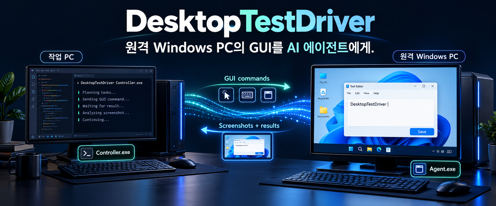
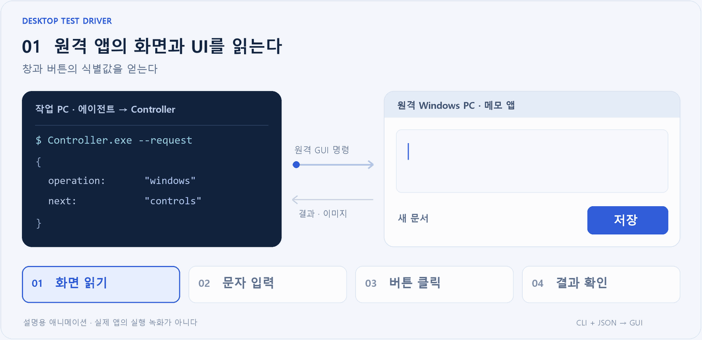

<p align="center">
  
</p>

<p align="center">
  <strong>코딩 에이전트가 원격 Windows 머신의 GUI 앱을 보고, 조작하고, 결과를 확인한다.</strong><br>
  에이전트는 작업 PC에, 조작할 앱은 네트워크 너머 다른 PC에.
</p>

<p align="center">
  <a href="#빠르게-시작하기">빠르게 시작하기</a> ·
  <a href="docs/gui-test-guide.md">GUI 테스트 가이드</a> ·
  <a href="docs/agent-usage.md">명령·설정 레퍼런스</a>
</p>

---

## 무엇을 하는 도구인가

**DesktopTestDriver는 코딩 에이전트가 원격 Windows 머신의 GUI 앱을 조작할 수 있게 해 주는 도구다.** 에이전트가 실행되는 작업 PC에서 명령을 보내면, 다른 PC에 있는 앱을 실행하고, 버튼을 클릭하고, 문자를 입력하고, 화면을 캡처한다.

Computer Use로 자신의 PC를 조작하는 에이전트도 **다른 머신의 화면을 읽고 그곳에 입력을 전달하려면 원격 제어 경로가 필요하다.** DesktopTestDriver는 작업 PC의 Controller와 원격 PC의 Agent를 연결해 이 경로를 제공한다. 에이전트가 원격 PC로 옮겨 갈 필요 없이, 원격 앱의 UI 정보와 화면을 돌려받아 작업을 이어 간다.

예를 들어 “**원격 테스트 PC**의 메모 앱에 문장을 입력하고 저장한 뒤, 다시 열어서 내용이 같은지 확인하라”는 작업을 맡길 수 있다. 작업 순서와 성공 여부는 작업 PC의 코딩 에이전트가 판단하고, 원격 PC의 Agent가 실제 GUI 명령을 수행한다.

| 이런 작업에 | 이렇게 활용한다 |
|---|---|
| **별도 테스트 PC의 앱 확인** | 원격 PC에서 입력 → 저장 → 다시 열기를 수행하고 결과를 회수한다 |
| **원격 환경의 UI 점검** | 다른 Windows 머신의 버튼·입력칸과 표시 값을 읽고 화면을 남긴다 |
| **여러 원격 PC의 결과 비교** | machineId로 대상을 선택해 각 PC의 UI와 캡처를 비교한다 |
| **PC 사이의 연동 테스트** | 한 원격 PC는 조작하고 다른 원격 PC는 관측 전용으로 열어 변화를 확인한다 |

## 한눈에 보는 사용 흐름

<picture>
  <source media="(prefers-reduced-motion: reduce)" srcset="docs/assets/control-loop.png">
  
</picture>

*위 애니메이션은 활용 흐름을 설명하는 예시이며 실제 앱의 실행 녹화가 아니다.*

**원격 화면 관측 → 원격 앱 조작 → 결과 회수**를 반복한다. 클릭과 입력은 원격 PC에서 실행되고, UI 정보와 캡처 이미지는 에이전트가 있는 작업 PC로 돌아온다. 에이전트는 원격 앱의 화면을 보고 다음 행동과 성공 여부를 판단한다.

## 어떤 일을 할 수 있나

| 기능 | 제공하는 작업 |
|---|---|
| **화면과 UI 읽기** | 창 목록, 버튼·입력칸 조회, 표시 값 읽기, 창 화면 캡처 |
| **마우스·키보드 조작** | 클릭, 이동, 끌기, 스크롤, 한글·영문 입력, 키 조합 |
| **앱과 연결 관리** | 앱 실행, 창 닫기, 도구가 실행한 앱 종료, PC별 세션 관리 |
| **관측 전용 사용** | 클릭이나 창 활성화 없이 UI와 화면만 조회 |
| **입력 복구와 결과 조회** | 누른 키·버튼 해제, 장애 시 독립 감시, 원래 요청의 실행 결과 재조회 |

연결에는 등록한 인증서를 사용한다. 같은 요청 번호와 내용을 다시 보내면 보관된 결과를 반환해 중복 실행을 막는다. 응답을 잃은 입력은 결과부터 조회하고, 화면을 다시 확인한 뒤 다음 행동을 결정한다.

## 어떻게 연결되나



| 프로그램 | 설치할 곳 | 하는 일 |
|---|---|---|
| **Controller.exe** | 코딩 에이전트와 같은 작업 PC | CLI 요청을 받아 대상 Agent에 전달하고 결과·이미지를 수집한다 |
| **Agent.exe** | 조작하거나 관측할 원격 Windows PC마다 | 그 PC에 로그인된 바탕화면에서 실제 GUI 명령을 수행한다 |

작업 PC에는 코딩 에이전트와 Controller를 두고, 원격 PC에는 Agent와 조작할 앱을 둔다. 각 Agent가 작업 PC의 Controller에 연결하며, 에이전트는 `machineId`로 원격 머신을 선택한다. **GUI 명령은 원격 머신에서 실행되고, 실행 결과와 이미지는 작업 PC로 돌아온다.**

파일 복사·로그 수집·서비스 관리에는 작업 PC의 로컬 명령이나 기존 SSH를 함께 사용한다.

## 빠르게 시작하기

### 1. 패키지 만들기

Windows 10/11 x64와 **.NET 10 SDK**가 설치된 PC에서 실행한다.

```powershell
.\build.ps1 -Package
```

`bin/live_Release`에 배포할 폴더가 만들어진다. 실행할 각 PC에는 **.NET 10 Desktop Runtime x64**가 필요하다.

| 폴더 | 배치할 곳 |
|---|---|
| `Controller/` | 코딩 에이전트가 있는 작업 PC |
| `Agent/` | GUI를 조작·관측할 각 원격 Windows PC |
| `test-apps/` | 예제를 따라 할 때 원격 PC에서 실행할 메모·입력 확인 앱 |

### 2. 연결 준비하기

[최초 설정 가이드](docs/agent-usage.md#최초-설정과-상주-실행)에 따라 역할별 상태 폴더를 만들고 공개 인증서를 교환·등록한다. Controller는 원격 PC에서 도달 가능한 주소로 수신하도록 설정하고, 설정한 TCP 포트의 방화벽 접근을 준비한다. 원격 PC의 Agent에는 이 Controller의 주소와 포트를 지정한 뒤 두 프로그램을 시작한다.

Agent는 원격 PC에 로그인한 일반 사용자의 콘솔 바탕화면에서 실행한다. 지원 범위는 일반 사용자 GUI이며 관리자 창·잠금 화면·RDP 세션과 HDR 색 정확도는 보장 범위에 포함하지 않는다.

### 3. 에이전트에게 작업 맡기기

코딩 에이전트에 **작업 PC의 Controller 경로, 원격 PC의 machineId, 원격 앱에서 수행할 작업**을 알려 준다. 다음은 다른 Windows 머신에 설치한 메모 앱을 사용하는 요청 예시다. 경로와 PC 이름은 자신의 환경에 맞게 바꾼다.

> 작업 PC의 Controller는 `C:\DesktopTestDriver\Controller\Controller.exe`다.<br>
> 조작할 대상은 다른 Windows 머신 `remote-pc`다.<br>
> DesktopTestDriver 사용 규약을 읽고 원격 PC의 `C:\GuiTest\SimpleMemo.exe`를 실행하라.<br>
> “테스트 메모입니다”를 새 파일에 저장한 뒤 다시 열어 내용이 같은지 확인하라.<br>
> 원격 화면을 작업 PC로 가져와 보관하고, 원격 PC에 이번에 만든 파일·앱과 제어 세션을 정리하라.

전체 절차는 [GUI 테스트 가이드](docs/gui-test-guide.md)에서 확인할 수 있다.

<details>
<summary><strong>직접 CLI로 첫 요청 보내기</strong></summary>

작업 PC의 Controller 폴더에서 연결된 원격 PC를 확인하고 조작 세션을 연다. `remote-pc`는 `--status`에 나온 실제 machineId로 바꾼다.

```powershell
.\Controller.exe --status
.\Controller.exe --session-open --machine remote-pc --mode control
```

응답의 `controlSessionId`를 아래 `REPLACE_SESSION_ID`에 넣어 `windows.json`으로 저장한다.

```json
{
  "apiVersion": 1,
  "requestId": "windows-001",
  "controlSessionId": "REPLACE_SESSION_ID",
  "operation": "windows",
  "arguments": {}
}
```

원격 PC의 창 목록을 조회하고, 작업이 끝나면 같은 세션 번호로 연결을 닫는다.

```powershell
.\Controller.exe --request .\windows.json
.\Controller.exe --session-close REPLACE_SESSION_ID
```

클릭·문자 입력 등 다른 작업도 같은 형식의 JSON 요청으로 보낸다. 대상 창과 버튼 식별값은 조회 결과를 사용하며, 입력 전에는 `focus`로 창을 활성화한다. 전체 명령과 오류별 처리 방법은 [사용 규약](docs/agent-usage.md)을 참고한다.

</details>

## 저장소 구성

| 디렉토리 | 내용 |
|---|---|
| `src/Controller/` | 작업 PC에서 요청을 받는 실행 프로그램 |
| `src/Agent/` | 원격 Windows PC에서 GUI를 관측·조작하는 실행 프로그램 |
| `src/Core/` | 통신, 화면 캡처, 입력, 세션과 복구 로직 |
| `src/Contracts/` | 요청·응답 형식과 공통 데이터 타입 |
| `fixtures/` | 메모·입력 확인용 예제 앱 |
| `tests/` | 명령 계약, 통신, 세션과 프로세스 검사 |
| `scripts/` | 실행 관리와 배포 패키지 검사 스크립트 |
| `docs/` | 사용 규약과 GUI 테스트 가이드 |
| `docs/assets/` | README의 그림과 애니메이션 |
| `bin/` | 빌드·배포 결과. 자동 생성 |
| `artifacts/` | 검사 결과와 진단 자료. 자동 생성 |

<details>
<summary><strong>소스 빌드와 검사</strong></summary>

```powershell
# Debug 빌드 → bin/Debug
.\build.ps1 -Configuration Debug

# Release 빌드·배포 패키지·로컬 검사
.\verify.ps1
```

검사 결과는 `artifacts/verify-...`에 저장된다. 로컬 검사는 실제 키보드·마우스 입력 없이 명령·통신·세션과 배포 패키지를 확인한다.

</details>

## 라이선스

[MIT License](LICENSE)
