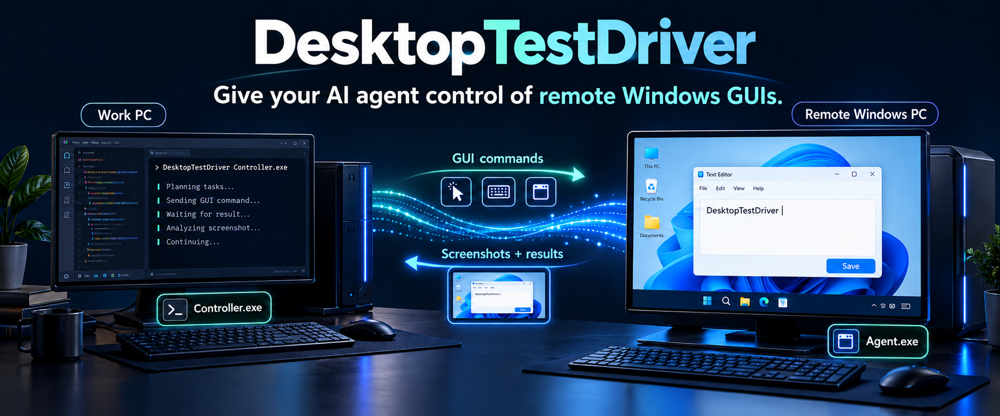
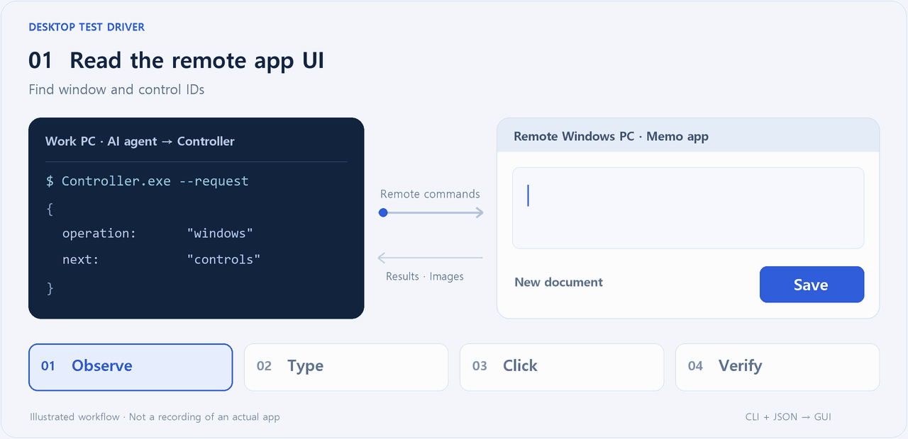

[한국어 README](README_kr.md)

<p align="center">
  
</p>

<p align="center">
  <strong>Let your coding agent observe, control, and verify GUI apps on remote Windows machines.</strong><br>
  The agent stays on your workstation. The app runs on another PC across the network.
</p>

<p align="center">
  <a href="#quick-start">Quick start</a> ·
  <a href="docs/gui-test-guide.md">GUI test guide (Korean)</a> ·
  <a href="docs/agent-usage.md">Command and setup reference (Korean)</a>
</p>

---

## What it does

**DesktopTestDriver lets a coding agent control GUI applications on a remote Windows machine.** Send commands from the agent's workstation to launch apps, click buttons, type text, and capture the screen on another computer.

An agent using Computer Use on its own computer still needs **a way to observe and send input to another machine**. DesktopTestDriver provides that path by connecting a Controller on the workstation to an Agent on the remote PC. The coding agent stays on its workstation and receives the remote app's UI data and screenshots to continue its work.

For example, ask it to "open the memo app on a **remote test PC**, enter and save a sentence, then reopen the file and check that the content matches." The coding agent on the workstation plans the steps and evaluates the outcome. The Agent on the remote PC executes the GUI commands.

| Use case | How it helps |
|---|---|
| **Test an app on a separate PC** | Enter text, save, reopen, and collect the results from the remote PC |
| **Inspect a remote UI** | Read controls and displayed values, and capture the screen on another Windows machine |
| **Compare multiple remote PCs** | Select each machine by machineId and compare its UI data and screenshots |
| **Test interactions across PCs** | Control one remote PC while observing another for the resulting changes |

## The control loop

<picture>
  <source media="(prefers-reduced-motion: reduce)" srcset="docs/assets/control-loop-en.png">
  
</picture>

*This animation illustrates the workflow. It is not a recording of an actual app execution.*

Repeat **observe the remote screen → control the remote app → collect the results**. Clicks and keystrokes execute on the remote PC. UI data and screenshots return to the workstation, where the coding agent decides what to do next and whether the task succeeded.

## What you can do

| Capability | Available operations |
|---|---|
| **Read screens and UI data** | List windows, inspect controls and displayed values, and capture app windows |
| **Use the mouse and keyboard** | Click, move, drag, scroll, enter Unicode text, and send key combinations |
| **Manage apps and sessions** | Launch apps, close windows, terminate tool-launched apps, and manage sessions for each PC |
| **Observe without input** | Inspect UI data and screens without clicking or activating windows |
| **Recover input and retrieve results** | Release held keys and buttons, recover through an independent watchdog, and query the original request's result |

Connections use registered certificates. Resending the same request ID and content returns the stored result to prevent duplicate execution. If an input response is lost, query its result first, inspect the screen again, and then decide the next action.

## How it connects



| Program | Where to install it | Role |
|---|---|---|
| **Controller.exe** | The workstation running the coding agent | Accept CLI requests, route them to the target Agent, and collect results and images |
| **Agent.exe** | Each remote Windows PC to control or observe | Execute GUI commands on that PC's logged-in desktop |

Run the coding agent and Controller on the workstation. Run the Agent and target app on the remote PC. Each Agent connects to the Controller, and the coding agent selects the remote machine by `machineId`. **GUI commands execute on the remote machine; results and images return to the workstation.**

Use local commands on the workstation or your existing SSH connection for file transfers, log collection, and service management.

## Quick start

### 1. Build the packages

Run this command on a Windows 10/11 x64 PC with the **.NET 10 SDK** installed.

```powershell
.\build.ps1 -Package
```

Deployment folders are created under `bin/live_Release`. Each PC running the tools needs the **.NET 10 Desktop Runtime x64**.

| Folder | Destination |
|---|---|
| `Controller/` | The workstation running the coding agent |
| `Agent/` | Each remote Windows PC to control or observe |
| `test-apps/` | Memo and input-check apps to run on the remote PC when following the examples |

### 2. Connect the machines

Follow the [initial setup guide (Korean)](docs/agent-usage.md#최초-설정과-상주-실행) to create separate state directories and exchange and register public certificates. Configure the Controller to listen on an address reachable from the remote PC, and allow access to its configured TCP port through the firewall. Set that Controller address and port on the remote Agent, then start both programs.

The Agent runs on the logged-in standard user's console desktop on the remote PC. The supported scope is standard-user GUI applications. Elevated windows, the lock screen, RDP sessions, and HDR color fidelity are outside that scope.

### 3. Give the coding agent a task

Provide **the Controller path on the workstation, the remote PC's machineId, and the task to perform in the remote app**. This example uses a memo app installed on another Windows machine. Replace the paths and machine name with those in your environment.

> The Controller on the workstation is `C:\DesktopTestDriver\Controller\Controller.exe`.<br>
> The target is a separate Windows machine named `remote-pc`.<br>
> Read the DesktopTestDriver usage reference and launch `C:\GuiTest\SimpleMemo.exe` on the remote PC.<br>
> Save "This is a test memo." to a new file, reopen it, and verify that the content matches.<br>
> Bring the remote screenshot back to the workstation, then clean up the file and app created on the remote PC and close the control session.

See the [GUI test guide (Korean)](docs/gui-test-guide.md) for the full walkthrough.

<details>
<summary><strong>Send your first request directly from the CLI</strong></summary>

From the Controller folder on the workstation, check the connected remote PCs and open a control session. Replace `remote-pc` with an actual machineId returned by `--status`.

```powershell
.\Controller.exe --status
.\Controller.exe --session-open --machine remote-pc --mode control
```

Replace `REPLACE_SESSION_ID` below with the response's `controlSessionId` and save the request as `windows.json`.

```json
{
  "apiVersion": 1,
  "requestId": "windows-001",
  "controlSessionId": "REPLACE_SESSION_ID",
  "operation": "windows",
  "arguments": {}
}
```

List the windows on the remote PC. When finished, close the session using the same session ID.

```powershell
.\Controller.exe --request .\windows.json
.\Controller.exe --session-close REPLACE_SESSION_ID
```

Send clicks, text input, and other operations using the same JSON request format. Use window and control identifiers returned by inspection, and activate the target window with `focus` before sending input. See the [usage reference (Korean)](docs/agent-usage.md) for all commands and error handling.

</details>

## Repository layout

| Directory | Contents |
|---|---|
| `src/Controller/` | The executable that receives requests on the workstation |
| `src/Agent/` | The executable that observes and controls the remote Windows GUI |
| `src/Core/` | Communication, screen capture, input, sessions, and recovery logic |
| `src/Contracts/` | Request and response formats and shared data types |
| `fixtures/` | Example memo and input-check apps |
| `tests/` | Command contract, communication, session, and process checks |
| `scripts/` | Runtime management and deployment package checks |
| `docs/` | Usage reference and GUI test guide |
| `docs/assets/` | README illustrations and animations |
| `bin/` | Generated build and deployment output |
| `artifacts/` | Generated test results and diagnostic files |

<details>
<summary><strong>Build from source and run checks</strong></summary>

```powershell
# Debug build -> bin/Debug
.\build.ps1 -Configuration Debug

# Release build, deployment packages, and local checks
.\verify.ps1
```

Results are saved under `artifacts/verify-...`. Local checks validate commands, communication, sessions, and deployment packages without sending real keyboard or mouse input.

</details>

## License

[MIT License](LICENSE)
