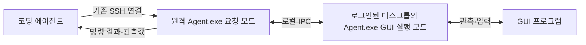

# DesktopTestDriver

> **DesktopTestDriver는 사람이 아닌 코딩 에이전트를 위한 도구다. 코딩 에이전트가 원격 Windows 머신의 GUI 프로그램을 관측하고 조작하는 데 사용한다.**

코딩 에이전트는 이미 SSH로 원격 머신에 접속해 파일·프로세스·서비스·로그를 다룬다. DesktopTestDriver는 로그인된 데스크톱에서 수행해야 하는 앱 실행, 창·UI 정보 조회, 화면 캡처, 키보드·마우스 조작을 담당한다.

**새 구조는 시나리오를 사용하지 않는다.** 코딩 에이전트가 계획을 세우고 필요한 GUI 명령을 하나씩 요청한다. 도구가 반환한 관측값과 화면을 보고 다음 행동과 제품의 성공·실패를 판단하는 주체도 코딩 에이전트다.

이 README는 앞으로 개발할 구조와 사용 방향을 설명한다. 기존 GUI 코드를 이 구조로 바꾸는 단계이며, 아래 요청 명령과 응답 형식은 아직 구현 전이다.

## 역할

| 작업 | 담당 |
|---|---|
| 조작 계획·순서·대기·재시도 | 코딩 에이전트 |
| 여러 원격 머신의 작업 조율 | 코딩 에이전트 |
| 파일·프로세스·서비스·로그 관리 | 코딩 에이전트가 기존 SSH 사용 |
| GUI 앱 실행·창 조회·화면 캡처·입력 | DesktopTestDriver |
| 제품 기능의 성공·실패 판정 | 코딩 에이전트 |
| 제품 연결 종료·설정 복원 계획 | 코딩 에이전트 |
| 도구가 누른 키·마우스 버튼의 해제 | DesktopTestDriver |

DesktopTestDriver의 실행 결과는 요청한 GUI 명령의 수행 여부와 관측값이다. 클릭 입력 전달 완료가 제품 연결 성공을 뜻하지는 않는다.

## 동작 구조

기존 `Agent.exe`에 다음 두 실행 모드를 둔다.

- **GUI 실행 모드:** 원격 머신의 로그인된 데스크톱에서 계속 실행하며 실제 창·화면·입력을 다룬다.
- **요청 모드:** 코딩 에이전트가 기존 SSH 셸에서 실행한다. 같은 머신의 GUI 실행부에 명령을 전달하고 JSON 응답을 출력한 뒤 종료한다.



새 SSH 클라이언트나 서버를 만들지 않는다. 중앙 Controller와 별도의 TCP 수신 포트도 새 구조에 요구하지 않는다. GUI 실행 모드는 설치·기동 단계에서 로그인된 사용자 세션에 시작해 두고, 요청 모드가 로컬 IPC로 연결한다.

## 에이전트의 사용 흐름

1. 기존 SSH로 원격 머신에 접속한다.
2. GUI 실행부의 상태와 지원 범위를 조회하고 제어 세션을 연다.
3. 창·UI 정보를 조회하거나 화면을 캡처해 조작 대상을 찾는다.
4. 클릭·문자 입력 등 필요한 GUI 명령을 요청한다.
5. 반환된 정보·이미지와 SSH로 확인한 로그를 보고 다음 행동을 정한다.
6. 작업을 마치면 필요한 앱 종료·제품 복원을 요청하고 제어 세션을 닫는다.

제어 세션은 여러 명령이 같은 데스크톱을 이어서 조작하기 위한 문맥이다. 시험 계획이나 기대 결과를 담지 않는다. 요청 프로세스가 종료돼도 세션은 유지되며, 에이전트가 화면을 분석하는 동안 계속해서 명령을 보낼 필요는 없다.

## 요청과 응답

다음은 구현할 요청 방식의 예다. 코딩 에이전트가 기존 SSH로 원격 머신에 요청 파일을 작성하고 실행한다. 세션·창·요소 식별값은 실제 관측 결과에서 얻는다.

```powershell
.\Agent.exe --request .\click.json
```

`click.json`에는 한 번의 GUI 명령만 넣는다.

```json
{
  "requestId": "click-001",
  "controlSessionId": "control-001",
  "operation": "click",
  "arguments": {
    "windowId": "win-007",
    "automationId": "ConnectButton"
  }
}
```

이 파일은 명령 메시지다. 단계 배열·분기·기대 결과를 담는 시나리오가 아니다. 명령을 받은 도구는 실행 결과를 반환한다.

```json
{
  "requestId": "click-001",
  "controlSessionId": "control-001",
  "operation": "click",
  "status": "completed",
  "data": { "windowId": "win-007", "inputEventsSent": 2 }
}
```

`completed`는 클릭 입력 전달을 마쳤다는 뜻이다. 에이전트는 이후 화면·UI 정보·로그를 보고 제품의 동작을 판단한다. 캡처 파일은 기존 SSH 파일 전송으로 가져와 실제 이미지를 열어 본다.

## 개발할 GUI 기능

| 기능 | 제공할 동작 |
|---|---|
| 상태 조회 | GUI 실행부·데스크톱 세션·지원 기능 확인 |
| 창·UI 관측 | 창 탐색, 요소 식별, 읽을 수 있는 UI 값 반환 |
| 화면 캡처 | 창·영역 이미지와 좌표·시각 정보 반환 |
| 앱·창 조작 | GUI 앱 실행, 포커스 변경, 명시적 종료 |
| 입력 | 클릭·이동·드래그·휠·문자·키 조합 |
| 입력 해제 | 도구가 누른 키·버튼 해제 |
| 요청 기록 | 응답 유실 시 실행 결과 조회와 중복 실행 방지 |

명령 오류가 나도 가능한 관측을 유지해 에이전트가 다시 판단할 수 있게 한다. 입력 해제와 앱 종료를 분리하고, 제어 세션을 닫았다는 이유만으로 제품 앱을 무조건 종료하지 않는다.

## 개발 상태와 문서

현재 저장소에는 기존 GUI 조작 코드와 Controller·시나리오 실행 코드가 남아 있다. 새 GUI 요청 경로를 구현하면서 재사용할 GUI 기능을 추출하고, 중앙 Controller 의존성과 시나리오 실행·제품 판정 계층을 분리한다.

이 README의 새 명령을 현재 실행 가능한 사용법으로 취급하지 않는다. 실제 구현·데스크톱 연동 확인이 완료되면 설치와 사용 명령을 갱신한다.

구체적인 실행 모드, 요청 예시, 변경할 코드, 구현 순서와 완료 기준은 [원격 GUI 조작 설계와 구현 계획](docs/agent-driven-desktop-control.md)에 정리한다.
