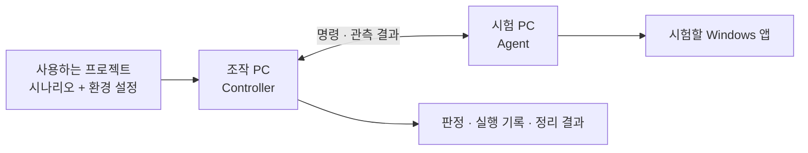

# DesktopTestDriver

DesktopTestDriver는 **여러 Windows PC의 데스크톱 프로그램을 시나리오대로 조작하고, 결과를 확인하는 개발·시험 도구**다. 프로그램 실행, 창과 버튼 조회, 키보드 입력, 마우스 조작, 화면 이미지 수집을 제공한다. 예를 들어 시험 앱을 실행하고 버튼을 클릭한 뒤, 앱이 기록한 결과나 화면의 UI 정보를 확인하는 시험을 만들 수 있다.

조작할 PC에는 **Controller**, 시험할 PC에는 **Agent**를 실행한다. 코딩 에이전트가 JSON 시나리오를 작성하면 Controller가 이를 읽고 Agent에 명령을 보내 실행·판정·정리를 진행한다. 새로운 앱을 시험할 때는 사용하는 프로젝트에 시나리오와 설정을 추가한다. Controller·Agent 소스를 수정하거나 앱별 어댑터를 만들 필요가 없다.

## 어떻게 사용하는가



| 구성 | 하는 일 |
|---|---|
| Controller.exe | 조작 PC에서 실행한다. 연결된 시험 PC를 관리하고 시나리오를 실행한다 |
| Agent.exe | 시험 PC의 로그인한 사용자 바탕화면에서 실행한다. Controller에 접속하고 해당 PC의 앱을 조작한다 |
| 시나리오 파일 | 무엇을 어떤 순서로 하고, 어떤 결과를 성공으로 볼지 정의한다 |
| 환경 설정 파일 | 시나리오의 역할을 실제 시험 PC에 연결하고, 허용할 앱·입력·시간 등을 지정한다 |

사용 순서는 **파일 준비 → 두 PC의 설정·실행 → 연결 확인 → 시나리오 준비 → 검사·실행 → 결과 확인**이다. Agent는 한 번 실행해 두고 여러 시나리오에 계속 사용한다. 시험 PC가 여러 대라면 각 PC에 Agent 하나씩을 실행한다.

아래는 수동 복사 방식으로 두 PC를 연결해 **입력 없이 사용자 세션 정보를 확인하는 첫 시나리오**를 실행하는 방법이다. 앱 실행·키보드·마우스 시험은 이 흐름을 익힌 뒤 별도의 입력 준비를 갖추어 작성한다.

## 1. 실행 파일을 준비한다

두 PC 모두 Windows 10 2004 이상 또는 Windows 11 x64와 **.NET 10 Desktop Runtime**이 필요하다. 소스를 빌드할 PC에는 **.NET 10 SDK**가 필요하다. .NET 10.x 안에서 마이너·기능 밴드·패치 버전이 같을 필요는 없다.

이미 배포용 파일을 받았다면 아래 빌드·게시 명령은 건너뛰고 폴더를 복사한다. 소스에서 준비한다면 `desktop-test-driver` 폴더에서 다음 명령을 실행한다.

```text
dotnet build DesktopTestDriver.slnx -c Release
dotnet publish src/Server/Server.csproj -c Release -r win-x64 --self-contained false -o dist/Server
dotnet publish src/Client/Client.csproj -c Release -r win-x64 --self-contained false -o dist/Client
dotnet publish src/Client.Watchdog/Client.Watchdog.csproj -c Release -r win-x64 --self-contained false -o dist/Client.Watchdog
```

프로젝트 폴더 이름은 Server/Client지만, 생성되는 실행 파일 이름은 Controller.exe/Agent.exe다. **EXE만 복사하지 않고 게시한 폴더 전체를 복사한다.** DLL·설정 파일도 필요하다.

| 복사할 곳 | 복사할 폴더 | 복사 후 예시 경로 |
|---|---|---|
| 조작 PC | `dist/Server` 전체 | `C:\DesktopTestDriver\Server\Controller.exe` |
| 시험 PC | `dist/Client` 전체 | `C:\DesktopTestDriver\Client\Agent.exe` |
| 시험 PC | `dist/Client.Watchdog` 전체 | `C:\DesktopTestDriver\Client.Watchdog\Client.Watchdog.exe` |

시험 PC에서 **Client와 Client.Watchdog은 같은 상위 폴더 아래** 있어야 한다. Watchdog은 연결 단절이나 작업 실행부 장애 시 입력 해제와 정리를 맡는 보조 프로그램이다. 사람이 따로 실행하지 않는다.

## 2. 두 PC의 연결 설정을 작성한다

이 예제에서 조작 PC의 IP는 `192.168.0.61`, 시험 PC의 이름은 `notebook-74`로 정한다. 실제 환경에 맞게 바꾼다. `notebook-74`는 Windows 컴퓨터 이름과 같을 필요가 없는, 시험 PC를 구분하는 ID다.

**조작 PC:** Controller.exe 옆의 `Controller.json`을 수정한다.

```json
{
  "host": "192.168.0.61",
  "port": 25071,
  "stateRoot": "state"
}
```

**시험 PC:** Agent.exe 옆의 `Agent.json`을 수정한다.

```json
{
  "machineId": "notebook-74",
  "host": "192.168.0.61",
  "port": 25071,
  "targetSession": 0,
  "stateRoot": "state"
}
```

두 파일의 `host`는 모두 **조작 PC의 주소**이고, `port`도 같아야 한다. Agent가 Controller로 접속한다. 조작 PC 방화벽에서 Controller.exe의 TCP 25071 수신을 시험 PC의 IP에 허용한다. 포트를 바꿀 때는 TCP 25001~25199 범위에서 정한다.

Agent.json의 `targetSession: 0`은 Agent를 직접 실행한 현재 로그인 세션을 뜻한다. `stateRoot`는 실행 기록을 저장할 전용 폴더다. 상대 경로는 각 EXE가 있는 폴더를 기준으로 하며 처음 실행할 때 자동 생성한다. 예제에서는 조작 PC의 `Server\state`, 시험 PC의 `Client\state`가 된다.

이 도구는 신뢰하는 개발 환경용이며 일반 TCP를 사용한다. TLS·HTTPS·연결 인증은 제공하지 않는다.

## 3. Controller와 Agent를 실행하고 연결을 확인한다

조작 PC에서 Controller.exe를 실행한다. 인자는 필요 없다. 이 Controller는 켜 둔다.

시험 PC에서는 로그인한 일반 사용자 바탕화면에서 Agent.exe를 실행한다. Agent가 Controller에 자동 접속한다. 관리자 권한이나 Windows 서비스 등록은 필요 없다.

조작 PC에서 **별도 터미널**을 열고 Controller.exe가 있는 `Server` 폴더로 이동해 다음을 실행한다.

```text
.\Controller.exe list
```

응답의 `data` 배열에서 다음 항목을 확인한다. 아래 값은 예시다.

| 항목 | 예시 | 확인할 내용 |
|---|---|---|
| `machineId` | `notebook-74` | Agent.json에 지정한 시험 PC ID |
| `session` | `1` | 실제 로그인 세션 번호. 다음 작업 설정에 사용한다 |
| `activeRun` | `null` | 현재 실행 중인 작업이 없다 |
| `cleanupBlocked` | `false` | 이전 작업의 정리 실패로 차단된 상태가 아니다 |

목록이 비어 있으면 아직 연결되지 않은 것이다. 먼저 Controller 기동, 두 설정의 host/port, 방화벽, 시험 PC의 Agent 실행 상태를 확인한다.

인자 없이 실행한 Controller.exe는 계속 동작하는 본체이고, `list` 등의 인자를 붙인 Controller.exe는 본체에 요청을 보내고 끝나는 관리 명령이다. 이후 명령도 같은 조작 PC의 Server 폴더에서 실행한다.

## 4. 첫 시나리오의 파일 세 개를 준비한다

시나리오는 **DesktopTestDriver를 사용하는 프로젝트의 폴더**에 둔다. 예를 들어 조작 PC에 다음과 같이 만든다. 이 세 파일을 시험 PC에 복사할 필요는 없다.

```text
C:\MyProject\tests\desktop\
  inspect.scenario.json
  lab.bindings.json
  target.run.json
```

| 파일 | 내용 | 바꾸는 시점 |
|---|---|---|
| `inspect.scenario.json` | 수행 순서와 기대 결과 | 시험할 내용이 바뀔 때 |
| `lab.bindings.json` | 역할 → 작업 설정 파일, 시나리오에 넣을 값 | 시험 환경이나 입력값이 바뀔 때 |
| `target.run.json` | 실제 머신·세션·허용 명령·유효 시간 | 실행 회차마다 새 runId와 만료 시각을 지정할 때 |

`observer`는 시나리오 안에서 쓰는 **역할 이름**이다. bindings가 이 역할을 target.run.json에 연결하고, run 파일의 machineId가 실제 Agent를 지정한다.

### inspect.scenario.json — 무엇을 확인할지

다음 시나리오는 사용자 세션 번호와 일반 바탕화면 상태를 조회한다. 앱 실행, 포커스 변경, 키보드·마우스 입력은 수행하지 않는다.

```json
{
  "schemaVersion": 1,
  "id": "inspect-session",
  "purpose": "입력 없이 사용자 세션과 일반 바탕화면 상태를 확인한다",
  "roles": ["observer"],
  "parameters": ["targetSession"],
  "maximumSeconds": 30,
  "steps": [
    {
      "id": "inspect",
      "role": "observer",
      "command": {"name": "inspect"},
      "expect": [
        {"path": "/observation/session", "op": "eq", "value": {"$ref": "/parameters/targetSession"}},
        {"path": "/observation/desktop", "op": "eq", "value": "Default"},
        {"path": "/observation/elevated", "op": "eq", "value": false}
      ]
    }
  ]
}
```

`command`는 Agent에 보낼 명령이고 `expect`는 관측 결과가 만족해야 할 조건이다. 여기서는 세 조건이 모두 맞아야 성공이다. `maximumSeconds`는 작업 시작과 정리를 포함한 전체 시간 상한이다.

### lab.bindings.json — 어느 환경에서 실행할지

```json
{
  "parameters": {"targetSession": 1},
  "roles": {"observer": "target.run.json"}
}
```

`targetSession`의 1은 앞서 `list`에서 확인한 실제 session 값으로 바꾼다. `target.run.json` 경로는 **이 bindings 파일이 있는 폴더 기준**이다.

### target.run.json — 이번 작업의 대상과 허용 범위

```json
{
  "protocolVersion": 2,
  "runId": "inspect-001",
  "machineId": "notebook-74",
  "role": "observer",
  "targetSession": 1,
  "expectedDesktop": "Default",
  "expiresAt": "REPLACE_WITH_FUTURE_ISO8601",
  "maxSeconds": 30,
  "recovery": "R0",
  "allowInput": false,
  "windows": [],
  "allowedKeys": [],
  "delegation": {
    "owner": "TEST-PC\\tester",
    "requester": "coding-agent",
    "keyId": "lab-owner",
    "scenarios": ["inspect-session"],
    "actions": ["inspect", "heartbeat"],
    "productPermissions": [],
    "evidence": {"retainHours": 24, "maxBytes": 67108864, "images": false},
    "signature": ""
  }
}
```

실행 전에 다음을 실제 환경 값으로 바꾼다.

| 항목 | 지정할 값 |
|---|---|
| `runId` | 매번 새 ID. 예: inspect-001 다음은 inspect-002. 사용한 ID는 재사용하지 않는다 |
| `machineId` | list에 표시된 시험 PC의 ID |
| `targetSession` | list의 session. bindings의 targetSession에도 같은 값을 지정한다. **run 파일에서는 0을 쓸 수 없다** |
| `expiresAt` | 현재보다 미래의 시각. 전체 30초를 수용할 여유를 두고, 시간대가 포함된 ISO 8601 형식으로 지정한다 |
| `delegation.owner` | 시험 PC의 실행 사용자. 시험 PC에서 whoami로 확인할 수 있다. JSON 안의 역슬래시는 두 번 적는다 |

expiresAt 값은 PowerShell에서 다음을 실행해 현재부터 10분 뒤의 UTC 시각을 얻을 수 있다. 출력한 값으로 `REPLACE_WITH_FUTURE_ISO8601`을 바꾼다.

```powershell
[DateTimeOffset]::UtcNow.AddMinutes(10).ToString('o')
```

R0는 입력 없는 관측용 구분이다. actions는 이 작업에서 허용하는 명령이며 heartbeat는 연결 감시에 필요하다. 현재 상시 연결 방식에서는 서명·인증 키를 만들 필요가 없고 signature는 빈 문자열로 둔다.

## 5. 시나리오를 검사하고 실행한다

조작 PC의 Server 폴더에서 먼저 파일만 검사한다.

```text
.\Controller.exe scenario-check C:\MyProject\tests\desktop\inspect.scenario.json C:\MyProject\tests\desktop\lab.bindings.json
```

`valid: true`가 반환되면 문법·역할·설정의 정적 검사를 통과한 것이다. 이 명령은 Agent에 접속하거나 앱·입력을 조작하지 않는다.

실행 준비가 끝나면 다음을 실행한다. **begin/request/end를 따로 실행할 필요가 없다.**

```text
.\Controller.exe scenario-run C:\MyProject\tests\desktop\inspect.scenario.json C:\MyProject\tests\desktop\lab.bindings.json
```

Controller가 대상 PC의 작업 시작 → inspect → expect 판정 → 작업 종료·정리까지 수행한다. 명령이 끝날 때까지 기다린 뒤 결과를 확인한다. Agent는 연결을 유지하므로 다음 시나리오에서도 다시 실행할 필요가 없다.

## 6. 결과를 확인한다

scenario-run 응답은 JSON이다. 성공하려면 `ok: true`와 함께 **`data.verdict: "Pass"`**가 있어야 한다. ok는 요청 처리 여부이며 시험 통과 판정과 다르다.

| 응답 항목 | 확인할 내용 |
|---|---|
| `data.executionId` | 이번 시나리오 실행을 식별하는 ID |
| `data.verdict` | 전체 Pass / Fail |
| `data.steps` | 단계별 Pass / Fail / NotRun. NotRun은 실행하지 않은 단계다 |
| `data.cleanup` | 시작을 시도한 역할별 정리 결과. verified가 true인지 확인한다 |
| `data.evidenceDirectory` | 실행 기록을 저장한 폴더 |

report.json은 Controller의 stateRoot 아래 저장된다. 이번 배치에서는 다음 위치다.

```text
C:\DesktopTestDriver\Server\state\scenarios\실행ID\
  plan.json         실행한 시나리오
  execution.json    사용한 환경 설정
  events.jsonl      명령별 관측 결과와 판정
  report.json       최종 판정과 정리 결과
```

이 예제의 Pass는 선언한 사용자 세션·바탕화면 상태를 관측하고 작업 정리를 확인했다는 뜻이다. 앱 입력 성공까지 검증한 것은 아니다. 버튼이나 텍스트를 시험할 때는 입력 후 앱의 상태·UI 정보·결과 파일을 확인하는 조건을 둔다.

명령 종료 코드는 성공 0, 실패 1이다. scenario-check 통과만으로 실제 시험을 통과한 것은 아니다. 실행 전 설정·연결 확인에서 거부되면 report.json 없이 오류 응답만 반환될 수도 있다.

## 자신의 앱을 시험할 시나리오를 만든다

코딩 에이전트에게는 별도 문서인 **[시나리오 작성 규약](docs/scenario-authoring.md)**을 전달한다. 이 문서에 전체 문법, 지원 명령, 관측값 참조, 대상 선택, 조건 대기, 판정 규칙과 예제가 있다.

다음 지시문을 사용하면 된다.

> DesktopTestDriver의 `docs/scenario-authoring.md`를 읽고, 이 프로젝트의 시험할 동작에 맞는 시나리오·bindings·run 파일을 작성하라. Controller·Agent 소스는 수정하지 마라. 실제 앱과 창을 관측해 대상을 식별하고, 입력 후 앱 결과를 확인하는 조건을 포함하라. 정적 검사와 실제 실행 결과를 구분하라.

앱 실행·키보드·마우스를 쓰는 run 설정에는 허용할 앱 경로·파일 hash·창·키·명령을 지정한다. `allowInput: true`와 **R1 이상의 입력 해제·화면 복귀 준비 증거**가 필요하다. 위 R0 예제에서 allowInput만 true로 바꾸는 것으로는 입력 시험을 준비할 수 없다. 자세한 run 필드는 [작업 설정 템플릿](inventory/run.template.json)과 작성 규약을 따른다.

| 할 수 있는 일 | 명령 예 |
|---|---|
| 등록한 프로그램 실행 | launch |
| 창·버튼·텍스트 등 UI 정보 조회 | inspect, controls |
| 창 선택·화면 이미지 수집 | focus, snapshot |
| 텍스트·키보드 입력 | type-window, text, chord |
| 마우스 이동·클릭·드래그·휠 | move-window, click-control, click-window, drag, wheel |
| 앱이 기록한 결과 파일 읽기 | read-artifact |

지원 범위는 일반 사용자 바탕화면의 앱이다. 자연어를 자동 해석하거나 관리자 UI·UAC·SAS·잠금 화면을 조작하는 기능, 임의 셸 명령 실행은 제공하지 않는다.

## 중단과 종료

첫 명령 오류·조건 실패·시간 초과에서 뒤 단계는 실행하지 않고 정리한다. 입력과 시나리오는 자동 재실행하지 않는다. 실패한 실행의 기록을 확인하고 원인과 준비를 보완한 뒤 새 runId로 실행한다.

시나리오 실행 중에 중단하려면 실행 명령 터미널에서 Ctrl+C를 누르거나, 조작 PC의 별도 터미널에서 다음을 실행한다.

```text
.\Controller.exe end notebook-74
```

시나리오가 여러 PC를 사용하는 경우에도 그중 한 PC에 end를 요청하면 해당 시나리오 전체를 중단한다. `cancellationRequested: true`는 중단 요청의 접수이며 정리 완료를 뜻하지 않는다. report.json에서 정리 결과를 확인한다. 실행 요청 CLI가 끊겨도 상시 Controller가 정리를 수행한다.

| 원하는 동작 | 조작 PC에서 실행할 명령 |
|---|---|
| 연결된 Agent 조회 | `.\Controller.exe list` |
| 작업 중단·정리, Agent는 유지 | `.\Controller.exe end notebook-74` |
| 작업 정리를 마친 Agent도 종료 | `.\Controller.exe exit notebook-74` |
| Controller 종료 | `.\Controller.exe shutdown` |

Agent까지 종료할 때는 시나리오 중단과 정리 완료를 먼저 확인한 뒤 exit를 실행한다. Controller가 종료되거나 연결이 끊기면 Agent도 진행 작업을 중단·정리한다. 정리를 확인하지 못한 상태에서는 새 시험을 시작하지 않는다.

## 연결이 안 되거나 실행이 거부될 때

| 증상 | 먼저 확인할 내용 |
|---|---|
| list가 실패한다 | 같은 Server 폴더의 Controller가 실행 중인지, 같은 사용자로 관리 명령을 실행하는지 확인한다 |
| list의 data가 비어 있다 | Agent 실행, 두 설정의 host/port, 조작 PC 방화벽을 확인한다 |
| scenario-check가 실패한다 | JSON 문법, 세 파일의 역할 이름, bindings 기준 run 경로, run 설정을 확인한다 |
| Expired | expiresAt이 충분히 미래인지 확인한다 |
| ReservationConflict | 이미 실행 중인 작업, 중복 Agent, 재사용한 runId 또는 세션 설정 불일치를 확인한다 |
| RecoveryRequired | 입력을 허용하는 작업에 필요한 R1 이상의 준비·복귀 증거가 있는지 확인한다 |
| AuthenticationFailed | 상태 폴더가 현재 실행 사용자 전용인지 확인한다. 다른 사용자가 만든 폴더를 stateRoot로 재사용하지 않는다 |
| report의 verdict가 Fail이다 | 처음 실패한 단계와 events.jsonl, cleanup 결과를 확인한다 |

실패한 상태에서 같은 시험을 반복하거나 상태 폴더를 지워 기록을 초기화하지 않는다. 수집한 증거로 원인을 확인한 뒤 영향받은 시험을 새 회차로 준비한다.

## 추가 사용법과 현재 상태

**수동 점검:** 시나리오 대신 명령 하나씩 보낼 수도 있다. `begin MACHINE RUN_JSON`으로 작업을 시작하고, `request MACHINE COMMAND_JSON`으로 명령을 보내고, `end MACHINE`으로 종료한다. 예를 들어 command.json이 `{"name":"inspect"}`이면 창과 세션을 조회한다. 시나리오 실행 중에는 이 수동 명령을 섞지 않는다. 일반 자동화에는 위 scenario-run 흐름을 사용한다.

**SSH 배포:** 직접 복사하는 대신 선택적인 Python SSH 배포 어댑터와 Broker로 파일 전송·사용자 세션의 Agent 기동을 자동화할 수 있다. 이 경우에만 Python·SSH·Broker가 추가로 필요하다. Broker를 게시하는 명령은 다음과 같다. 기동 후 작업 제어는 수동 복사 방식과 동일한 Controller↔Agent TCP 경로다.

```text
dotnet publish src/Client.Broker/Client.Broker.csproj -c Release -r win-x64 --self-contained false -o dist/Client.Broker
```

**프로세스 수:** 머신당 상시 Agent는 하나다. 작업 중에만 별도의 작업 실행부와 watchdog이 추가되고, UI 조회 시 임시 보조 프로세스가 생길 수 있다. 이들은 도구가 관리하며 작업 종료 후 상시 Agent가 남는다. 한 머신에서 동시에 한 작업을 실행하고 여러 머신을 함께 사용할 수 있다.

현재 구현은 빌드까지 확인했다. 시나리오 실행·다중 머신·실제 입력·장애 복귀 검증은 아직 수행하지 않았다. 이 문서의 실행 절차와 예제는 사용법이며, 해당 시험의 PASS 기록이 아니다.

| 더 알아볼 내용 | 문서 |
|---|---|
| 코딩 에이전트가 따라야 할 시나리오 문법 | [시나리오 작성 규약](docs/scenario-authoring.md) |
| Controller·Agent의 실행·통신 계약 | [Controller / Agent 계약](docs/controller.md) |
| 복합 제품 시험에 부족한 기능과 추가 개발 항목 | [사용 준비 상태와 추가 개발 항목](docs/readiness-and-gaps.md) |
