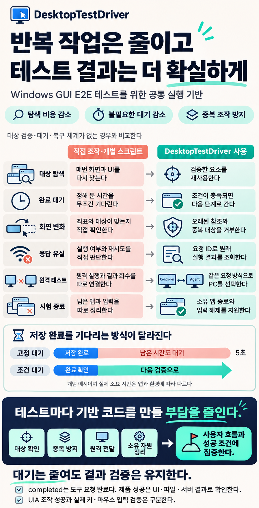

# DesktopTestDriver

**DesktopTestDriver는 Windows GUI E2E 테스트에서 반복되는 화면 탐색·대기·재시도·뒷정리 비용을 줄이는 도구다.** 코딩 에이전트가 매번 화면에서 버튼을 찾고, 넉넉한 시간을 기다리고, 응답이 끊긴 조작의 실행 여부를 추측해야 한다면 테스트는 느려지고 결과도 불안정해진다. DesktopTestDriver는 확인한 UI 요소를 다시 사용하고, 기대한 상태가 나타나면 대기를 끝내고, 원래 요청의 실행 기록을 조회하도록 해 **불필요한 작업을 줄이면서 성공과 실패를 더 정확하게 판정하도록 돕는다.**

도입하면 테스트마다 직접 만들던 대상 확인·중복 실행 방지·원격 명령 전달·소유 프로세스 정리를 공통 기능으로 사용할 수 있다. 코딩 에이전트나 테스트 실행기는 **어떤 사용자 흐름을 시험하고 무엇을 성공으로 볼지**에 집중한다. 같은 PC와 원격 테스트 PC에 같은 요청 방식을 사용한다.

[GUI 테스트 가이드](docs/gui-test-guide.md) · [명령·설정·API 규약](docs/agent-usage.md) · [English README](README.md)



## 사용하지 않을 때와 무엇이 달라지는가

아래는 화면·좌표 조작이나 개별 스크립트로 테스트하면서 별도의 대상 검증·대기·복구 체계를 갖추지 않은 경우와의 비교다. 다른 자동화 도구나 직접 구현으로 같은 기능을 갖출 수도 있다. DesktopTestDriver의 도입 이점은 이 공통 기반을 테스트마다 따로 구현하고 유지할 부담을 줄이는 데 있다.

| 테스트에서 하는 일 | 직접 조작·개별 스크립트로 처리할 때 | DesktopTestDriver를 사용할 때 |
|---|---|---|
| 버튼·입력칸을 반복해서 찾는다 | 매 단계 화면을 해석하거나 전체 UI를 다시 탐색한다 | 찾은 요소 참조를 검증해 재사용하고 필요한 영역만 검색해 반복 탐색을 줄인다 |
| 앱의 처리 완료를 기다린다 | 고정 대기가 길면 시간을 낭비하고 짧으면 준비 전에 다음 단계가 실행된다 | 기대한 값·창이 나타났는지 조건으로 확인하고, 충족되면 다음 단계로 넘어간다 |
| 화면이 바뀐 뒤 조작한다 | 좌표나 저장한 식별자가 여전히 유효한지 직접 확인해야 한다 | 프로세스·창·요소 신원을 검증하고 오래된 참조와 중복 대상을 거부해 오조작을 줄인다 |
| 클릭 뒤 응답이 끊긴다 | 실제 실행 여부와 재시도 가능 여부를 직접 추적해야 한다 | 요청 ID로 원래 결과를 조회한다. 보관된 같은 ID·내용의 요청은 다시 실행하지 않아 중복 조작을 막는다 |
| 다른 PC에서 시험한다 | 원격 실행·화면 회수·결과 전달 경로를 별도로 연결해야 한다 | Controller와 Agent를 한 번 설정한 뒤 machineId로 대상을 선택하고 UI 정보와 화면을 받는다 |
| 실패 후 다음 시험을 준비한다 | 남은 앱·자식 프로세스·누른 키를 찾아 정리하는 코드를 따로 만들어야 한다 | 세션 소유 앱·자식 프로세스 종료와 도구 입력 해제를 지원하고 정리 결과를 반환한다 |

예를 들어 저장 버튼을 누른 뒤 항상 5초를 기다리는 스크립트는 저장이 일찍 끝나도 남은 시간을 소비한다. 조건 대기를 사용하면 저장 완료 표시를 관측한 시점에 이어 갈 수 있다. 그다음 파일을 다시 열어 내용까지 확인해야 저장 E2E가 통과한다. **대기 시간을 줄이는 것과 검증 단계를 생략하는 것은 다르다.**

반복 실행이 많거나, UI 변화·응답 유실 때문에 재시도가 잦거나, 여러 Windows PC를 시험할 때 특히 유용하다. 기존 자동화가 이미 같은 보호·복구 기능을 갖췄다면 도입 효과는 현재 구성과 비교해 판단한다. 실제 시간 단축 폭은 앱과 환경에 따라 달라지며, 시험 순서와 최종 성공 조건은 호출자가 정한다. `completed`는 도구 요청 완료이므로 UI·파일·서버의 제품 결과를 별도로 확인한다.

GUI 의미 조작은 API 2의 UI Automation(UIA)을 사용한다. 실제 키보드·마우스 경로를 시험해야 할 때는 명시적인 입력 정책을 사용한다. UIA의 성공은 실제 키·마우스 입력 경로의 검증을 뜻하지 않는다. UIA 미지원 작업을 전역 입력으로 자동 대체하지 않는다.

## 권장 테스트 흐름

1. **성공 조건을 정한다.** 화면 표시, 저장 후 다시 읽은 내용, 서버 결과 등 확인할 항목과 전체 시험 마감 시간을 정한다.
2. **환경과 대상을 확인한다.** `--status`와 `--doctor`로 Agent·사용자 세션·지원 기능을 확인하고 대상 프로세스 범위를 지정한다.
3. **필요한 요소를 찾는다.** API 2의 `find-element`로 찾은 `elementId`·`snapshotToken`을 재사용하고, 새 항목은 해당 패널 안에서 검색한다.
4. **조작하고 조건을 기다린다.** `set-value`·`invoke` 뒤 `wait-condition` 또는 `wait-window`를 사용한다. 각 요청은 최대 5초이며, 더 긴 준비 대기는 호출자가 전체 마감 시간 안에서 새 읽기 요청으로 이어 간다.
5. **제품 결과를 판정한다.** UI 값과 필요할 때의 화면·파일·로그를 확인한다. 요청 전달 완료만으로 통과시키지 않는다.
6. **근거를 남기고 정리한다.** 실패·미확정 결과를 보존하고 이번 시험에서 시작한 앱·세션·Agent·Controller와 테스트 파일을 정리한다. 시험 전부터 사용하던 프로세스는 유지한다.

화면 캡처는 시각적 확인이 필요한 시점에 사용한다. 반복적인 값 확인은 UIA 조회를 활용한다. 파일·서버·외부 API 검증에는 해당 제품의 기존 도구를 함께 사용한다. DesktopTestDriver Core에는 제품별 업무 API나 전체 시나리오 실행기를 넣지 않는다.

## 같은 PC와 원격 PC에서 사용한다

| 프로그램 | 배치 위치 | 역할 |
|---|---|---|
| `Controller.exe` | 코딩 에이전트 또는 테스트 실행기의 PC | 요청을 대상 Agent로 전달하고 결과와 이미지를 수집한다 |
| `Agent.exe` | 테스트할 앱이 있는 Windows PC | 로그인된 사용자 데스크톱에서 GUI를 관측·조작한다 |

같은 PC에서는 두 프로그램을 함께 실행하고 `127.0.0.1`로 연결한다. 원격에서는 대상 PC마다 Agent를 실행하고 `machineId`로 선택한다. 어느 구성에서도 인증서 등록과 대상·세션 검사를 적용한다.



위 그림은 원격 구성 예시다. 원격 제어는 E2E 실행 수단 중 하나이며 별도 PC가 필수인 것은 아니다.

| 사용 환경 | 적용 조건 |
|---|---|
| 다른 작업과 함께 쓰는 PC | 기본 `shared` 정책을 사용한다. 백그라운드 UIA 조작은 앱 프로필과 동작별 비간섭 인증이 필요하다 |
| 실제 키·마우스 입력 시험 | `foreground-exclusive`와 유효한 입력 lease가 필요하다. 사용자 입력과 경합하지 않는 시간에 실행한다 |
| 전용 테스트 환경 | Agent의 `machineUsage: dedicated`와 `isolated-desktop` 정책을 사용할 수 있다. 이 정책 자체가 새 데스크톱이나 VM을 만들지는 않는다 |
| 콘솔·RDP | 일반 사용자의 활성 콘솔 또는 연결된 활성 RDP 세션에서 실행한다. 잠금·연결 끊김·보안 데스크톱·관리자 실행은 지원하지 않는다 |

## 빠르게 시작하기

### 1. 빌드하고 배치한다

Windows 10/11 x64와 .NET 10 SDK가 있는 PC에서 실행한다.

```powershell
.\build.ps1 -Package
```

결과는 `bin/live_Release`에 생성된다. 실행 PC에는 .NET 10 Desktop Runtime x64가 필요하다. `Controller/`, `Agent/`, `Client/`, `test-apps/`가 포함되며 역할 폴더에는 문서·Schema·독립 예제가 들어 있다.

### 2. 연결하고 확인한다

[최초 설정과 상주 실행](docs/agent-usage.md#최초-설정과-상주-실행)에 따라 상태 폴더를 분리하고 공개 인증서를 교환·등록한 뒤 Controller와 Agent를 시작한다. 원격 구성에서는 Controller의 수신 주소와 TCP 포트 접근도 준비한다.

```powershell
.\Controller.exe --status
.\Controller.exe --doctor --machine test-pc
```

`test-pc`는 실제 등록된 `machineId`로 바꾼다. 기존 앱을 먼저 관측하려면 PID·시작 시각·EXE 경로·SHA-256으로 구성한 대상 범위 JSON을 준비해 동봉 예제를 실행한다.

```powershell
.\examples\standalone\Inspect.ps1 -Controller .\Controller.exe -Machine test-pc -TargetScope C:\GuiTest\scope.json
```

이 예제는 API 2 관측 세션을 열고 대상 UI를 읽은 뒤 세션을 닫는다. 조작 시험의 정책 선택과 요청 예시는 [사용 규약](docs/agent-usage.md), 메모 저장·재열기 절차는 [GUI 테스트 가이드](docs/gui-test-guide.md)를 따른다.

### 3. 코딩 에이전트에 시험을 맡긴다

> Controller는 `C:\DesktopTestDriver\Controller\Controller.exe`이며 대상 machineId는 `test-pc`다. 사용 규약을 읽고 `C:\GuiTest\SimpleMemo.exe`에서 문장 입력·저장·종료·재열기를 시험한다. 다시 읽은 내용이 일치해야 통과다. 전체 마감 시간을 정하고 지원되는 UIA와 조건 대기를 활용한다. 실제 입력이 필요한 단계는 해당 정책을 명시한다. 실패하면 요청 ID와 관측 근거를 남기고 실행 여부가 불명확한 조작을 반복하지 않는다. 이번 시험에서 만든 파일과 시작한 프로세스·세션을 정리하고, 확인한 결과와 미확인 항목을 구분해 보고한다.

## 검증 범위와 성능을 해석한다

```powershell
# 소스 빌드다.
.\build.ps1 -Configuration Debug
# Release 빌드·패키지·로컬 계약 및 통신 검사다.
.\verify.ps1
```

로컬 검사는 실제 키·마우스 입력이나 두 물리 PC의 제품 E2E 통과를 의미하지 않는다. 별도의 UIA 시험과 실제 입력 시험도 구분한다. UIA는 모든 앱·컨트롤을 지원하지 않으며, 캡처는 가려짐·최소화 등에서 거부될 수 있고 HDR 색 정확도를 보장하지 않는다.

2026-11-06 작업 트리 검증에서는 로컬 테스트 60개와 FormsWorkbench·SimpleMemo 실제 UIA 시험 2개가 통과했다. UIA 시험의 전역 입력과 대상 창 전경 전환은 0건이었다. 합성 관측 4,001개 노드의 부모 선택자 탐색은 같은 실행에서 순차 참조 100.54ms, 인덱스 검색 0.40ms였다. 이는 특정 탐색 구간의 단일 측정이며 전체 E2E 속도 보장은 아니다. 두 물리 PC, 실제 입력, 사용자 동시 작업은 이 검증에 포함하지 않았다.

해당 로컬 근거는 `artifacts/e2e-audit-local.txt`, `artifacts/e2e-audit-ui.txt`, `artifacts/ui-tests/e934cab8f20448279a286cb47e4a909b/`에 있다. 자동 생성한 로컬 산출물이므로 새 clone에는 포함되지 않는다. 다른 환경에서는 준비·조작·조건 대기·증거 수집·정리 시간과 실패·재시도 횟수를 따로 측정한다.

<details>
<summary>저장소 구성이다</summary>

| 경로 | 내용 |
|---|---|
| `src/Controller/`, `src/Agent/` | 요청 전달과 Windows GUI 실행 프로그램이다 |
| `src/Client/` | C# 호출 API다 |
| `src/Core/`, `src/Contracts/` | 통신·UIA·입력·정리 구현과 요청·응답 계약이다 |
| `fixtures/`, `tests/` | 테스트 앱과 자동 검증이다 |
| `schemas/`, `examples/standalone/` | DTO Schema와 독립 사용 예제다 |
| `scripts/`, `docs/` | 운영 스크립트와 사용 문서다 |
| `bin/`, `artifacts/` | 자동 생성되는 배포 결과와 검증 근거다 |

</details>

## 라이선스

[MIT License](LICENSE)를 따른다.
