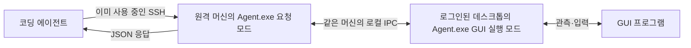

# 코딩 에이전트의 원격 GUI 조작 도구: 방향과 구현 계획

작성 기준: 2026-10-20의 저장소 코드. 이 문서는 DesktopTestDriver의 사용 목적, 현재 구현과의 차이, 변경할 코드와 완료 기준을 함께 정리한다. **새 Agent.exe 명령은 아직 구현되지 않았다. 이 문서와 사용 규약은 구현할 목표이며, 현재 배포본의 사용 가능성을 뜻하지 않는다.** README도 이 목표 구조를 설명한다. 기존 실행 경로는 현재 코드와 [기존 Controller / Agent 계약](controller.md)에서 확인할 수 있다.

## 구현 기준과 코딩 에이전트에게 전달할 문서

| 문서 | 읽는 대상 | 기준으로 삼을 내용 |
|---|---|---|
| 이 문서 | 구현하는 개발자·코딩 에이전트 | 목적·책임·제거 범위·변경 코드·개발 순서·완료 기준 |
| [코딩 에이전트용 사용 규약](agent-usage.md) | 도구를 호출하는 코딩 에이전트 | 명령 인자·JSON 필드·응답 상태·종료 코드·대상 선택·오류 후 행동 |
| [README](../README.md) | 처음 프로젝트를 접하는 사람·에이전트 | 도구의 목적과 문서 진입점 |

실제 호출에는 사용 규약과 원격 Agent.exe 경로를 전달한다. 계획을 보관할 특별한 문법이 필요한 것이 아니라, 에이전트가 **관측 → 한 번의 요청 → 응답 해석 → 다음 행동**을 반복할 수 있는 호출 규약이 필요하다.

구현자는 사용 규약의 필드·상태·부수 동작을 임의로 바꾸지 않는다. API를 바꾸면 두 문서와 예시·검사를 함께 바꾼다. 새 로컬 요청 API는 `apiVersion: 1`로 구분하며 기존 `Wire.Version`과 혼용하지 않는다. 아래 설명보다 상세한 요청·응답 규칙은 사용 규약을 따른다.

사용 규약을 배포본의 docs에 동봉하고 `Agent.exe --help`에서 위치·버전을 안내한다. `--status`는 실제 지원 작업과 제한을 반환한다. 구현하지 않은 작업을 지원 목록에 넣지 않는다. 저장소 내부 구조나 이전 대화 내용을 알아야만 사용할 수 있는 도구로 만들지 않는다.

## 목적과 판단

> **DesktopTestDriver는 사람이 아닌 코딩 에이전트를 위한 도구다. 코딩 에이전트가 원격 Windows 머신의 GUI 프로그램을 관측하고 조작하는 데 사용한다.**

코딩 에이전트는 이미 SSH로 원격 머신에 접속해 파일·프로세스·서비스·로그를 다룬다. DesktopTestDriver가 제공할 것은 로그인된 데스크톱에서의 앱 실행·창 조회·화면 캡처·키보드·마우스 조작이다.

**현재 GUI 조작 핵심은 사용할 수 있지만, 시나리오를 실행하고 제품 Pass/Fail을 판정하는 상위 구조는 이 목적보다 커졌다.** 계획·판정 계층을 밖으로 옮기고, GUI 요청과 관측값 반환을 기본 경로로 바꾼다. 전체 코드를 버리고 다시 만들 필요는 없다.

**새 구조는 시나리오 파일과 시나리오 실행기를 사용하지 않는다.** 에이전트가 계획을 세우고 한 번 조작한 뒤, 화면·로그를 보고 다음 행동을 정한다. 반복 실행용 스크립트가 필요하면 사용하는 프로젝트가 PowerShell·Python 등으로 작성한다. 전용 시나리오 DSL·expect·제품별 adapter를 요구하지 않는다.

## “SSH CLI”라고 부른 것은 무엇인가

앞선 표현은 **이미 접속한 SSH 셸에서 실행할 GUI 요청 명령**을 뜻했다. SSH 클라이언트·SSH 서버·새 SSH 연결 프로그램을 만든다는 뜻이 아니다. 혼동을 줄이기 위해 이 문서에서는 이를 **Agent.exe의 GUI 요청 명령**이라고 부른다.

만들 것은 다음 두 실행 모드다. 별도의 DesktopTestDriver.exe를 새로 만드는 것을 전제로 하지 않고, 기존 `Agent.exe`에 진입점을 추가한다.

| 실행 모드 | 실행되는 곳 | 구체적으로 추가할 동작 |
|---|---|---|
| GUI 실행 모드 | 로그인된 사용자 데스크톱 | `Agent.exe --desktop-host`가 창·화면·입력을 실제로 다루며 계속 실행 |
| 요청 모드 | 에이전트가 이미 접속한 SSH 셸 | `Agent.exe --request request.json`이 같은 머신의 GUI 실행부에 요청을 전달하고 JSON 응답을 출력한 뒤 종료 |

상태 조회와 제어 세션 열기·닫기도 같은 Agent.exe의 명령으로 추가한다. 명령 계약은 사용 규약에 정의하며, 현재 Agent.exe가 지원하는 인자와는 다르다. `Host`는 GUI 실행 모드의 역할을 부르는 이름이지, 반드시 추가해야 하는 별도 실행 파일이 아니다.



요청 모드가 SSH 세션에서 직접 입력 API를 호출하지 않는다. 같은 머신의 로그인된 데스크톱에 있는 실행부가 GUI 작업을 수행한다. 통신에는 기존 Named Pipe 코드를 활용한다. 중앙 Controller와 별도의 TCP 수신 포트는 새 기본 경로에 요구하지 않는다.

GUI 실행부는 설치·기동 단계에서 로그인된 사용자 세션에 시작한다. 현재 Broker의 대화형 예약 작업 기동 코드를 재사용할 수 있다. 코딩 에이전트가 매 명령마다 Host를 재실행하지 않는다. 로그인된 GUI 세션이 없으면 그 상태를 반환한다. SSH로 로그인했다는 사실만으로 GUI 로그인 세션이 생긴 것으로 취급하지 않는다.

## 책임 구분

| 작업 | 코딩 에이전트 | DesktopTestDriver |
|---|---|---|
| E2E 시험 계획 | 목적·순서·성공 조건을 정한다 | 계획을 해석하거나 제품을 판정하지 않는다 |
| 파일·프로세스·서비스·로그 | 기존 SSH와 파일 전송 기능을 사용한다 | GUI 세션에서 수행해야 하는 조작을 제공한다 |
| 창·화면 관측 | 반환된 데이터·이미지를 읽는다 | 창 목록·UI 정보·캡처를 반환한다 |
| 마우스·키보드 | 대상과 입력 내용을 지정한다 | 해당 데스크톱에서 실행한다 |
| 여러 PC·대기·재시도 | 관측을 반복하고 다음 행동을 결정한다 | 각 요청의 실행 결과와 현재 상태를 반환한다 |
| 제품 정리·복원 | 필요한 GUI·SSH 명령을 요청한다 | 명시적으로 요청한 조작을 수행한다 |
| 도구 입력 해제 | 필요하면 해제를 요청한다 | 장애·만료 시에도 자기 입력의 해제를 관리한다 |

“클릭 입력을 전달했다”는 도구의 실행 결과이고, “제품 연결이 성공했다”는 에이전트의 판단이다. 창 식별·요청 형식·입력 전달 여부를 확인하는 것은 GUI 명령 실행에 필요한 처리다. 제품 기능의 성공·실패와 구분한다.

서비스 관리, 임의 프로그램 실행, 일반 파일 읽기를 위한 별도 확장 프로그램 체계를 도구 안에 만들지 않는다. 기존 SSH로 수행한다. 제품별 OCR·영상 분석·로그 분석도 에이전트나 사용하는 프로젝트의 도구에 둔다.

## 시나리오 구조의 제거 범위와 대체 구조

**시나리오 파일이 선택 사항으로 남는 구조가 아니다. 새 제품 실행 경로에서 시나리오 파서·실행기·제품 판정기를 제거하고, 단일 GUI 요청 처리기로 대체한다.** 요청 JSON은 데이터 메시지이며 단계·분기·기대 결과를 실행하는 DSL로 확장하지 않는다.

| 제거·대체 대상 | 새 구조에서의 처리 |
|---|---|
| `ScriptScenario`, `ScriptStep`, `ScriptBindings`, `ScriptExecution` | 제품 계약에서 제거. `GuiRequest`·`GuiResponse`·`ControlSession`처럼 단일 요청과 실행 문맥을 표현하는 계약으로 대체한다. 새 타입명은 역할을 설명하는 이름이다 |
| `steps`, `select`, `expect`, `waitFor`, `$ref`, roles·bindings | 새 요청에서 받지 않는다. 에이전트가 응답을 읽고 다음 요청의 실제 인자를 작성한다 |
| `ScriptScenarioRunner`, `ScenarioRunner`, `ResultJudge`, `AdapterRegistry` | 제품 실행 경로에서 제거. 작업별 GUI 처리 함수로 직접 분배하고 명령 결과만 반환한다 |
| `scenario-check`, `scenario-run`과 시험 실행용 명령 | 최종 배포 명령에서 제거. `--help`, `--status`, 세션 명령, `--request`, `--request-status`로 대체한다 |
| 제품 Pass/Fail·시나리오 보고서·계획 해시·역할별 동기화 | 에이전트 또는 사용하는 프로젝트가 수행한다. 도구에는 요청 기록·관측값·입력 해제 상태만 둔다 |
| 기존 `RunConfig`의 role·시나리오 해시·R1 사전 증거 등 | 설치 설정과 간단한 제어 세션으로 대체한다. 실제 사용자 접근과 명령 대상 식별은 유지한다 |
| 시나리오 ID를 사용하는 `seal-input`·`resume-input` | 시나리오 조건을 제거하고 `control`·`observe` 세션 모드로 대체한다. observe는 실제 변경 명령을 거부한다 |
| `scenarios/` 예제와 기존 시나리오 작성 문서 | 새 배포본 사용 안내에서 제거한다. 테스트에 필요한 자료만 테스트 전용 위치에 두며 사용자 기능으로 노출하지 않는다 |
| 제품별 fixture·adapter, Campaign·Preparation·Acceptance 계층 | 새 GUI 경로의 의존성을 끊는다. 도구 자체 시험에 쓸 공통 기능은 테스트 쪽에 추출하고 제품 시험 프레임워크를 남기지 않는다 |

전환 중 기존 코드에서 창 식별·UIA·입력 해제 등을 추출할 수는 있다. 다만 전환 완료 뒤 새 명령을 호출하는 데 기존 시나리오 타입이나 실행기가 필요한 상태는 허용하지 않는다. 단순히 파일명을 바꾸고 `expect`·반복 실행을 새 요청 처리기에 숨기는 것도 이 설계에 맞지 않는다.

## 현재 코드에서 재사용할 부분과 변경할 부분

| 현재 코드 | 현재 동작 | 변경 방향 |
|---|---|---|
| [ApplicationStartup.cs](../src/Core/ApplicationStartup.cs) | Controller의 `begin/request/end`로 개별 요청 가능 | 개발 중 기존 경로를 참고하고 새 Agent.exe 요청 진입점 추가. 최종 기본 경로는 로컬 요청 처리 |
| [DesktopActions.cs](../src/Core/DesktopActions.cs) | 창 재조회·요소 선택·포커스·입력 | 창·요소 선택과 입력 코드를 추출하고 자동 포커스는 명시적 focus로 분리 |
| [WindowsDesktop.cs](../src/Core/WindowsDesktop.cs), [CommandEngine.cs](../src/Core/CommandEngine.cs) | 창 식별·UIA·캡처·입력 | GUI 실행 핵심으로 유지·개선 |
| [Client.Broker/Program.cs](../src/Client.Broker/Program.cs), [Ipc.cs](../src/Core/Ipc.cs) | 대화형 세션 기동과 로컬 Named Pipe 통신 | GUI 실행부 기동과 같은 머신의 요청 전달에 재사용 |
| [PersistentAgent.cs](../src/Core/PersistentAgent.cs), [ClientController.cs](../src/Core/ClientController.cs) | 중앙 Controller와 TCP 연결·수명 관리 | 중앙 연결 의존성을 제거하고 로컬 제어 문맥으로 전환 |
| [Protocol.cs](../src/Contracts/Protocol.cs), [RunStore.cs](../src/Core/RunStore.cs) | 역할·작업 설정·복구 증거·명령 기록 | 설치 설정·제어 세션·요청 기록으로 단순화 |
| [Input.cs](../src/Core/Input.cs), [OwnedApplications.cs](../src/Core/OwnedApplications.cs) | 입력 해제와 소유 앱 종료 | 두 동작과 정책을 분리 |
| [ControllerCli.cs](../src/Core/ControllerCli.cs) | 이미지 분할 수신·크기·해시 확인 | 파일 처리 로직을 재사용하고 Controller 의존성 제거 |
| [ScriptScenarioRunner.cs](../src/Core/ScriptScenarioRunner.cs)와 시험 실행 계층 | 단계별 조건·제품 Pass/Fail·여러 머신 조율 | 새 GUI 기본 경로에서 분리 |

현재도 Controller에서 `begin MACHINE RUN_JSON` → `request MACHINE COMMAND_JSON` → `end MACHINE`으로 시나리오 없이 조작할 수 있다. 다만 중앙 TCP 연결과 복잡한 작업 설정이 필요하다. 기존 SSH/Broker 경로도 서명된 설정·프로토콜 필드·heartbeat 등의 계약을 사용한다. 요청 진입점만 기존 Agent.exe에 붙이면 모든 의존성이 해결되는 상태는 아니다.

현재 `WindowsDesktop.ConsoleValid`는 활성 콘솔의 일반 사용자 `Default` 바탕화면을 요구한다. 모든 RDP 세션·잠금 화면·UAC 화면을 지원한다고 설명하지 않는다. 실제 지원 범위는 상태 조회에서 반환하고, 확장은 별도 작업으로 다룬다.

## 에이전트의 호출 예

다음은 구현 후 **기존 SSH로 접속한 원격 PowerShell에서 실행할 명령**의 예다. 새 SSH 접속 도구나 전용 시험 시나리오를 사용하지 않는다. 경로와 ID는 예시이며 실제 응답값으로 바꾼다.

```powershell
# 설치된 명령과 사용 규약 위치를 확인한다.
.\Agent.exe --help

# 같은 머신의 GUI 실행부 상태를 조회한다.
.\Agent.exe --status

# 제어 문맥을 연다. 반환된 ID가 control-001이라고 가정한다.
.\Agent.exe --session-open --idle-seconds 900

# 아래 요청 파일은 에이전트가 기존 SSH로 원격 머신에 작성한다.
.\Agent.exe --request .\windows.json
.\Agent.exe --request .\controls.json
.\Agent.exe --request .\focus.json
.\Agent.exe --request .\click.json
.\Agent.exe --request .\capture.json

# 제품 확인과 추가 조작이 끝나면 제어 문맥을 닫는다.
.\Agent.exe --session-close control-001
```

`windows.json`은 한 번의 창 조회 요청이다.

```json
{
  "apiVersion": 1,
  "requestId": "windows-001",
  "controlSessionId": "control-001",
  "operation": "windows",
  "arguments": {}
}
```

에이전트가 창 조회와 controls 결과에서 실제 대상 창·버튼을 선택하고, 명시적인 focus로 전경 창을 맞춘 뒤 `click.json`을 작성한다. controls·focus의 완전한 요청 예시는 사용 규약에 있다. 이 파일에는 단계 배열·조건·기대 결과가 없다.

```json
{
  "apiVersion": 1,
  "requestId": "click-001",
  "controlSessionId": "control-001",
  "operation": "click",
  "arguments": {
    "windowId": "win-007",
    "automationId": "ConnectButton"
  }
}
```

`capture.json`은 결과 화면을 원격 머신의 파일에 저장하는 요청이다.

```json
{
  "apiVersion": 1,
  "requestId": "capture-001",
  "controlSessionId": "control-001",
  "operation": "capture",
  "arguments": {
    "windowId": "win-007",
    "output": "C:\\Temp\\connection.png"
  }
}
```

`C:\Temp\connection.png`는 원격 파일이다. 에이전트는 기존 SFTP·파일 전송 기능으로 가져와 실제 이미지를 열어 본다. 원격 경로를 반환했다는 이유만으로 에이전트가 화면을 본 것으로 취급하지 않는다.

클릭 응답은 다음처럼 명령 실행 사실을 표현한다. `completed`와 `inputEventsSent`는 입력 전달 결과이며 제품 연결 성공을 뜻하지 않는다.

```json
{
  "apiVersion": 1,
  "requestId": "click-001",
  "controlSessionId": "control-001",
  "operation": "click",
  "status": "completed",
  "data": { "windowId": "win-007", "inputEventsSent": 2 },
  "error": null,
  "observedAt": "2026-10-20T06:30:00Z"
}
```

창 없음·중복 대상·지원하지 않는 데스크톱은 요청별 오류로 반환한다. 기존 Result.Verified처럼 의미가 넓은 필드는 명령 상태·관측값·입력 해제 결과로 나눈다. 변경 명령의 응답을 잃었다면 `Agent.exe --request-status control-001 click-001`로 먼저 조회하고, 자동으로 같은 클릭을 다시 보내지 않는다.

## 필요한 GUI 작업

| 작업 | 반환할 정보·동작 |
|---|---|
| 상태·지원 범위 | 사용자·실제 데스크톱 세션·사용 가능한 명령·제한 사항 |
| 제어 문맥 열기·조회·닫기 | 제어 ID·유휴 만료 시각·소유 입력 상태 |
| `windows`, `controls` | 창·요소 식별값, 위치, UIA 정보와 읽을 수 있는 값 |
| `capture` | 이미지 파일·캡처 ID·대상·좌표 기준·관측 시각 |
| `launch`, `focus` | GUI 세션에서 앱 실행·명시적 창 활성화 |
| `click`, `move`, `drag`, `wheel`, `type-text`, `key`, `chord` | 지정한 대상에 입력 전달 |
| `release-input`, `close-window`, `terminate-owned` | 입력 해제 또는 명시적으로 요청한 종료 |
| 요청 결과 조회 | 동일 요청 ID의 수락·완료·실행 미확정 상태 |

제어 세션은 여러 번의 요청이 같은 데스크톱을 이어서 조작하기 위한 문맥이다. 시험 계획·제품 성공 조건을 담지 않는다. 짧게 실행되는 요청 모드 프로세스가 종료되어도 GUI 실행부와 제어 세션은 유지된다.

## 구현 항목과 완료 기준

다음 D01~D10은 GUI 도구 전환을 위한 개발 항목이다. 앞서 작성한 시나리오·preflight 확장 계획은 이 계획으로 대체한다.

### D01. 기존 Agent.exe에 요청 모드와 GUI 실행 모드 추가

**현재 부족한 점:** 현재의 `Controller.exe request`는 중앙 Controller의 로컬 관리 명령이다. 원격 Agent.exe에 GUI 요청을 전달하는 간단한 진입점은 없다. 기존 Broker·SSH 경로도 작업 설정·서명·heartbeat 등에 의존한다.

**구현 방법:**

1. `Client/Program.cs`에 `--desktop-host`, `--help`, `--status`, `--session-open`, `--session-status`, `--request`, `--session-close`, `--request-status` 진입점을 추가한다. 요청 모드는 기존 SSH 셸에서 실행되고, GUI 실행 모드는 로그인된 데스크톱에서 실행된다. `Client.Broker/Program.cs`의 대화형 사용자 예약 작업 기동 코드를 재사용한다.
2. `Ipc.cs`의 Named Pipe 요청·응답 코드를 공통화한다. Agent.exe 요청 모드가 한 개의 JSON 명령을 보내면 GUI 실행 모드가 실행하고 결과를 반환한다. operation과 arguments를 GUI 실행 명령으로 변환하고, 같은 제어 문맥의 일반 입력은 순서대로 처리한다. 정상 응답은 표준 출력, 진단 로그는 표준 오류로 분리한다. 중앙 Controller의 연결 파일이 있어야 동작하는 의존성을 제거한다.
3. 처음에는 SSH 사용자와 데스크톱 사용자가 같은 계정인 환경을 지원한다. 사용자별 IPC 접근과 상태 폴더 권한을 설치 단계에서 설정한다. 다른 계정 접근은 별도 설정으로 다룬다.
4. `Agent.exe --status`에 실제 사용자·데스크톱 세션·GUI 실행부 생존·지원 명령·제한 사항을 반환한다. 로그인 세션이 없거나 바탕화면이 지원 범위 밖이면 구체적인 이유를 반환한다.

**주요 코드:** `src/Client/Program.cs`, `src/Client.Broker/Program.cs`, `ApplicationStartup.cs`, `Ipc.cs`, `ClientController.cs`, `PersistentAgent.cs`.

**완료 기준:** 중앙 Controller와 추가 TCP 수신 포트 없이 SSH에서 창·세션 조회를 수행한다. GUI 로그인 세션이 없으면 `NoInteractiveSession`과 같은 이유를 반환한다. Agent.exe 요청 모드가 종료되어도 GUI 실행 모드는 유지된다.

현재 `WindowsDesktop.ConsoleValid`는 활성 콘솔의 일반 사용자 `Default` 바탕화면을 요구한다. 모든 RDP 세션·잠금 화면·UAC 화면을 지원한다고 표시하지 않는다. 추가 바탕화면 지원은 별도 범위로 개발한다.

### D02. 설정을 설치 정보와 GUI 제어 세션으로 단순화

**현재 부족한 점:** 개별 명령에도 `RunConfig`의 역할·만료·명령 범위·R1·`RecoveryEvidence` 등이 필요하다. GUI를 잠시 조작하려는 에이전트에게 시험 실행기의 설정을 요구한다.

**구현 방법:**

1. 설치 설정에는 Host 사용자, IPC 접근, 지원 데스크톱, 출력 위치 등 머신별 값을 둔다. 매 조작마다 같은 값을 다시 작성하지 않게 한다.
2. `Agent.exe --session-open`은 control·observe 모드와 유휴 시간 등 필요한 옵션만 받아 `controlSessionId`를 반환한다. 후속 명령은 그 ID로 실행 문맥을 이어간다. 세션은 시험 목적이나 기대 결과를 담지 않는다. 실제 필드·기본값과 세션 조회 방법은 사용 규약을 따른다.
3. 요청 순번·내부 IPC 정보는 도구가 관리한다. `role`, 시나리오 해시, bindings, 제품별 허용 시나리오 ID는 새 기본 계약에서 요구하지 않는다. 기존 설치 환경의 접근 권한은 유지한다.
4. R1 사전 증거를 일반 GUI 조작의 필수 조건에서 제거한다. `RunConfig.Validate`, `RunStore`, `Authorization`의 기존 검증을 그대로 통과해야만 새 경로가 열리는 구조로 만들지 않는다.
5. 도구가 누른 키·버튼을 해제하는 동작은 유지한다. 별도 복구 훈련·제품 복원 확인은 에이전트가 필요할 때 수행한다. 도구가 환경 준비 전체를 합격·불합격으로 판정하는 preflight는 만들지 않는다.

**주요 코드:** `Protocol.cs`, `RunStore.cs`, `Authorization.cs`, `ApplicationStartup.cs`, `PersistentAgent.cs`.

**완료 기준:** 시나리오·bindings·회차별 run 파일이나 사전 복구 증거 없이 제어 세션을 열 수 있다. 실제 접근 불가·지원하지 않는 데스크톱·중복 제어 등의 실행 오류는 원인을 반환한다.

R1은 기존 프로젝트에서 입력 해제·시험 소유 앱 종료 수준을 부르는 이름이다. 제품 연결 종료, 서비스·설정 복원까지 보장하는 뜻이 아니다. 이 명칭과 사전 증거를 코딩 에이전트가 알아야 할 필수 지식으로 삼지 않는다.

### D03. 처음 보는 창과 UI 요소를 발견하고 읽기

**현재 부족한 점:** `WindowsDesktop.Inspect`는 사전 등록한 경로·해시·제목 범위의 창만 반환한다. 앱을 관측해 대상을 찾으려면 먼저 앱 정보를 설정해야 하는 제약이 있다. UIA에는 실제 입력값 읽기가 부족하다.

**구현 방법:**

1. `windows`는 접근이 허용된 데스크톱의 관측 가능한 창 목록을 반환한다. 창 탐색을 위해 모든 앱의 파일 해시를 먼저 등록하도록 강제하지 않는다. 앱 범위를 제한해야 하는 환경은 설치 설정에서 지정한다.
2. 창 ID를 HWND·PID·프로세스 생성 시각·실행 경로와 연결해 저장한다. 같은 HWND가 재사용되어도 이전 창으로 취급하지 않는다. 입력 직전에 실제 식별값을 다시 대조한다.
3. `controls`는 요소 ID, AutomationId, 이름, 종류, 영역, 활성 상태를 반환한다. `ValuePattern`·`TextPattern`을 지원하면 실제 값과 읽기 가능 여부도 반환한다. 미지원·빈 값·조회 실패를 구분하고 암호 값은 내보내지 않는다.
4. 현재 UIA 보조 프로세스 격리를 재사용해 응답하지 않는 앱의 조회를 제한 시간 안에 중단한다. 한 번의 UIA 실패가 다른 관측이나 입력 해제를 막지 않게 한다.

**주요 코드:** `WindowsDesktop.cs`, `Protocol.cs`의 `WindowIdentity`·`UiNode`, `DesktopActions.cs`.

**완료 기준:** 에이전트가 사전 등록하지 않은 접근 가능한 창을 발견하고 UI 정보를 읽는다. PID/HWND 재사용·조회 불가·중복 요소를 구분하며, 임의의 첫 요소를 선택하지 않는다.

### D04. 명시적인 GUI 조작과 입력 없는 관측 분리

**현재 부족한 점:** 입력 명령은 있으나 낮은 수준의 프레임·창 정보를 호출자가 많이 전달해야 한다. 일부 편의 경로는 자동 포커스 변경을 포함하고, 전역 입력 충돌 상태가 읽기 요청까지 막을 수 있다.

**구현 방법:**

1. `focus`, `click`, `move`, `drag`, `wheel`, `type-text`, `key`, `chord` 등 구체적인 명령을 제공한다. `DesktopActions`의 창 재조회·요소 선택·입력 코드를 재사용하되 자동 포커스 부분은 분리한다. 입력할 창이 전경이 아니면 ForegroundMismatch를 반환하며, 에이전트가 명시적 focus를 요청하도록 한다.
2. `windows`·`controls`·`capture` 같은 읽기 명령은 포커스를 바꾸거나 입력을 보내지 않는다. 제품을 통해 외부 입력이 도착하는 동안에도 관측만 하는 세션을 사용할 수 있게 한다.
3. 좌표의 기준을 창 내부 또는 화면으로 명시하고, 캡처 크기·DPI·모니터 배치를 함께 제공한다. 요소 ID 입력은 실행 직전 다시 조회한다. 이미지 좌표 입력은 참조 캡처와 현재 창 식별·배치를 비교하고 달라졌으면 거부한다.
4. 현재 1.5초인 프레임 유효 시간만으로 에이전트의 이미지 분석 시간을 제한하지 않는다. 명령별로 재조회 또는 새 캡처 요구를 결정하고, 오래된 좌표를 무제한 허용하지 않는다. 창 배치가 같아도 내용이 달라질 수 있다는 한계는 숨기지 않는다.
5. 외부 입력 감시와 요청 실행 정책을 분리한다. 동시 조작으로 입력을 거부하더라도 가능한 읽기 요청까지 모두 차단하지 않는다. 어느 원격 제품이 입력했는지와 제품 입력 성공 여부는 에이전트가 판단한다.

**주요 코드:** `DesktopActions.cs`, `CommandEngine.cs`, `WindowsDesktop.cs`, `Input.cs`.

**완료 기준:** 관측 요청이 앱 포커스·입력 내용을 바꾸지 않는다. 에이전트가 관측한 창·요소에 조작을 요청하고, 대상 변경·모호한 선택·좌표 기준 오류는 입력 전에 확인할 수 있다.

### D05. 에이전트가 실제로 열어 볼 수 있는 화면 반환

**현재 부족한 점:** 캡처와 이미지 분할 읽기 코드는 있으나 중앙 Controller·작업 설정에 연결되어 있다. 현재 캡처는 전경 창을 전제로 하며, 원격 이미지 경로만으로 에이전트가 화면을 볼 수 있는 것은 아니다.

**구현 방법:**

1. 창 캡처를 로컬 GUI 실행부에서 수행하고 캡처 ID, 생성 시각, 대상 식별, 영역·DPI, PNG 경로·바이트 수·해시를 반환한다. 데스크톱·영역 캡처는 명시적인 추가 기능으로 제공한다.
2. `CommandEngine.ReadFrame`과 `ControllerCli.SaveFrame`의 분할 읽기·크기·해시 검사 로직을 재사용하고 중앙 Controller 의존성을 제거한다. 요청 모드는 같은 원격 머신의 지정 파일에 저장하거나 이미지 바이트를 내보낸다.
3. 원격 파일 경로를 반환하는 경우 에이전트가 기존 SFTP·파일 전송 기능으로 가져오도록 명세에 적는다. 제어 세션을 닫았다는 이유만으로 이미 반환한 캡처 파일을 즉시 삭제하지 않는다.
4. 다른 창으로 전환해 캡처하는 동작을 읽기 명령에 숨기지 않는다. 요청한 범위를 관측할 수 없으면 사유를 반환한다. 캡처 API 실패와 검은색·빈 화면이라는 관측 결과를 구분한다. 화면 내용을 제품 실패로 판정하지 않는다.
5. 크기·전송 시간·보관량에 상한을 두고 불완전한 파일은 완료로 반환하지 않는다. 로그·이미지에 제품 Pass/Fail을 붙이거나 별도 E2E 근거 묶음을 만들지 않는다.

**주요 코드:** `WindowsDesktop.Capture`, `CommandEngine.ReadFrame`, `ControllerCli.SaveFrame`, `Protocol.cs`의 `Frame`.

**완료 기준:** SSH에서 캡처한 파일을 에이전트가 전송받아 실제 이미지로 열 수 있다. 캡처 대상·좌표 정보·파일 해시가 대응하며, 전송 실패와 지원하지 않는 캡처를 구분한다.

### D06. 요청 오류 후에도 다시 관측하고 조작하기

**현재 부족한 점:** `CommandEngine`은 수락한 명령이 실패하면 `store.Stop`과 `input.Cleanup`을 호출한다. 요소를 못 찾은 정도의 오류에도 앱이 종료되어 에이전트가 원인을 확인할 기회를 잃을 수 있다.

**구현 방법:**

1. 창·요소 없음, 모호한 대상, 오래된 캡처, UIA 미지원은 요청 오류로 반환하고 제어 세션과 앱을 유지한다. 다음 관측·다른 조작을 허용한다.
2. 실제 데스크톱 변경, 입력 실행부 장애, 만료는 변경 입력을 중지할 사유로 다룬다. 중지 뒤에도 상태·로그·가능한 관측을 얻을 경로를 남긴다.
3. 입력 일부 수행 시에는 도구가 누른 입력을 해제하고 일부 실행 또는 실행 미확정 상태를 반환한다. 자동으로 같은 입력을 반복하지 않는다.
4. 응답에는 오류 코드, 대상 정보, 관측 시각, 요청의 수락·실행 여부를 구체적으로 넣는다. 제품 동작의 Pass/Fail 대신 명령 상태를 표현한다.

**주요 코드:** `CommandEngine.Execute`, `InputController`, `Client/Program.cs`, `Protocol.cs`의 `Result`.

**완료 기준:** 없는 요소를 클릭한 뒤에도 같은 세션에서 화면을 캡처하고 다른 요소를 조작한다. 오류가 나도 앱이 임의 종료되지 않는다. 입력 실행부 장애는 정상 입력 완료처럼 보고되지 않는다.

### D07. 요청 ID와 실행 결과 조회

**현재 부족한 점:** 현재 Controller는 요청을 보낼 때마다 명령 ID를 새로 만든다. 기존 중복 방지와 기록만으로는 에이전트가 잃어버린 응답을 동일 요청 ID로 다시 조회하는 간단한 계약이 완성되지 않는다.

**구현 방법:**

1. 변경 명령에 호출자가 지정한 `requestId`를 받는다. 같은 제어 세션에서 같은 ID·같은 내용은 저장된 결과를 반환하고 다시 실행하지 않는다. 같은 ID·다른 내용은 거부한다.
2. 입력 전에 수락 기록을 저장하고 완료 시 실제 실행 결과를 기록한다. 프로세스 재시작 후에도 조회할 수 있도록 최소 요청 기록을 디스크에 보존한다.
3. `Agent.exe --request-status`로 수락·실행 중·완료·실행 미확정 여부를 조회한다. 입력 전달 중 Host가 종료되어 결과를 확정할 수 없으면 `completionUnknown`으로 응답한다.
4. 요청 수명과 기록 보관 기간을 정해 반환하고, 기록이 없거나 만료된 요청을 임의로 성공·미실행으로 해석하지 않는다. 에이전트가 화면을 다시 보고 재시도 여부를 결정하게 한다.

**주요 코드:** `CommandEngine`의 명령 중복 처리, `RunStore`, `ControllerAgent.Peer.Build`, Agent.exe 요청·응답 계약.

**완료 기준:** 클릭 완료 응답을 유실시킨 뒤 같은 ID로 조회해 중복 클릭을 막는다. 수락과 완료 사이에서 실행부를 종료하면 미확정 상태를 반환한다. 정확히 한 번 실행을 보장한다고 표시하지 않는다.

### D08. 에이전트의 판단 시간과 내부 생존 감시 분리

**현재 부족한 점:** 현재 Controller는 개별 요청 사이에도 내부 heartbeat를 유지하지만, 새 직접 요청 경로에서는 이 중앙 프로세스를 사용하지 않는다. 기존 작업의 최대 15분 제한과 입력 유지·프레임 수명도 새 제어 문맥에 맞춰 나눠야 한다. 에이전트의 다음 요청을 내부 생존 신호 대신 사용하지 않는다.

**구현 방법:**

1. Host와 Watchdog 사이의 내부 생존 신호를 유지한다. 에이전트에게 몇 초마다 heartbeat 명령을 작성하도록 요구하지 않는다.
2. 짧게 실행되는 Agent.exe 요청 모드의 정상 종료를 제어 세션 종료로 취급하지 않는다. 다음 요청 프로세스가 같은 `controlSessionId`로 이어서 관측·조작할 수 있게 한다.
3. 제어 세션의 유휴 만료, 개별 명령 제한 시간, 키·버튼 최대 유지 시간을 각각 관리한다. 내부 장애 감지를 위한 짧은 제한을 에이전트의 전체 작업 시간에 적용하지 않는다.
4. `chord`·`drag`는 한 요청 안에서 누름·해제를 마친다. 길게 유지해야 하는 입력은 명시적으로 요청하고, 최대 유지 시간을 넘기면 도구가 해제한다.
5. 내부 생존 감시·상태 조회·요청 결과 조회가 일반 GUI 명령의 실행 대기열에 막히지 않게 한다. 응답하지 않는 UIA 작업이 있어도 실행 중 상태를 조회하고 Watchdog가 도구 입력을 해제할 수 있어야 한다.

**주요 코드:** `WatchdogRunner.cs`, `Input.cs`의 `WatchdogPolicy`, `PersistentAgent.cs`, `ClientController.cs`, `Protocol.cs`의 시간 설정.

**완료 기준:** 설정된 유휴 시간 안에서 에이전트가 수십 초 동안 이미지를 분석한 뒤에도 조작을 이어간다. 요청 모드 프로세스가 종료돼도 유지되지만 Host 장애·유휴 만료 시에는 도구가 누른 입력을 해제한다.

### D09. 입력 해제와 앱 종료를 분리

**현재 부족한 점:** 현재 `InputController.Cleanup`은 입력 해제와 소유 프로세스 종료를 함께 수행한다. `OwnedApplications`의 Job Object도 실행부가 닫히면 앱을 종료하도록 설정되어 있다.

**구현 방법:**

1. 입력 해제와 프로세스 종료를 별도 함수·결과로 분리한다. 일반 오류·세션 종료·만료 때는 도구 입력과 제어 자원을 정리한다.
2. 기본 앱 수명은 제어 세션을 닫아도 유지하는 것으로 둔다. `close-window`, `terminate-owned` 또는 앱 실행 시 명시한 종료 정책에 따라 앱을 닫는다. 도구가 실행하지 않은 앱을 소유 프로세스로 취급하지 않는다.
3. 현재 `KILL_ON_JOB_CLOSE`와 실행부·Watchdog의 종료 경로를 함께 바꾼다. 명령 옵션만 바꾸고 실제 실행부 종료 때 앱이 사라지는 동작을 남기지 않는다.
4. 입력 해제 결과와 앱 종료 결과를 따로 반환한다. 제품 앱을 남기기로 한 상태를 정리 실패로 처리하지 않는다. 반대로 입력 해제 실패는 확인 가능한 상태로 남긴다.
5. 제품 연결 종료·서비스 복원·설치 롤백은 에이전트가 GUI와 SSH로 요청한다. DesktopTestDriver가 제품 전체를 원상 복구했다고 판정하지 않는다.

**주요 코드:** `InputController.Cleanup`, `OwnedApplications`, `WatchdogRunner`, `Client/Program.cs`, `PersistentAgent.EndLocked`.

**완료 기준:** 세션을 닫으면 도구 입력은 해제되고 기본 정책의 앱은 유지된다. 명시적으로 소유 앱 종료를 요청하면 해당 앱만 종료된다. 앱을 남겼다는 이유만으로 새 제어 세션이 차단되지 않는다.

### D10. 시나리오 실행 계층 제거와 에이전트용 호출 규약 제공

**현재 부족한 점:** 기존 실행 코드에는 시나리오 파서·실행기·판정기와 관련 명령이 남아 있다. 새 사용 문서와 실제 구현이 일치하는지도 아직 확인하지 않았다. 코드의 제거 범위와 배포 문서의 사용 가능 기준을 함께 확정해야 한다.

**구현 방법:**

1. 사용 규약을 새 요청 계약의 기준으로 삼는다. 요청 형식, 좌표 기준, 포커스 동작, 응답 상태, 종료 코드, 제한 시간, 오류 후 행동, 이미지 획득법을 구현과 일치시킨다.
2. 앞의 제거 범위 표에 따라 시나리오 명령·타입·파서·실행기·판정기와 GUI 제품 코드의 의존성을 제거한다. 재사용할 창 식별·입력 해제 기능은 먼저 추출한다. 기존 시나리오를 새 제품의 호환 기능으로 유지하지 않는다.
3. 예전 시나리오·fixture·adapter 중 도구 자체 시험에 필요한 자료만 테스트 전용 위치로 옮긴다. 새 배포본에 시나리오 명령이나 작성 규약을 기본 사용법으로 포함하지 않는다.
4. README에서 호출하는 에이전트에게 사용 규약을 읽도록 안내하고, 배포본에도 같은 문서를 동봉한다. --help와 --status로 문서·API 버전·실제 지원 기능을 찾을 수 있게 한다.
5. 사용 규약의 예시를 계약 검사에 사용한다. 실제 SSH에서 다른 호출자가 이 문서만 보고 관측·조작·이미지 확인·오류 복구를 수행하는 확인까지 끝내야 사용 가능으로 표시한다.

**주요 코드·문서:** `ApplicationStartup.cs`, `Server/Program.cs`, `ScriptScenario*.cs`, `Scenarios.cs`, `Campaign.cs`, `Preparation.cs`, `Acceptance.cs`, README, 기존 시나리오 문서.

**완료 기준:** 배포 제품의 명령 목록·요청 계약·실행 경로에 시나리오 실행 기능과 제품 Pass/Fail이 없다. 기존 코드 구조를 모르는 코딩 에이전트가 동봉된 사용 규약과 실제 응답만으로 창 조회 → 명시적 focus·조작 → 이미지 확인 → 다음 요청 → 세션 종료를 수행한다. 오류 뒤의 행동도 문서대로 확인한다.

## RemoteAssist를 사용하는 예

1. 에이전트가 대상 PC와 지원자 PC에 기존 SSH로 접속한다.
2. 파일·프로세스·서비스·로그를 SSH로 준비하고 GUI 실행이 필요한 앱은 각 머신의 Agent.exe에 요청한다.
3. 대상 PC의 창·화면을 조회하고 동의·접속 정보 입력을 요청한다.
4. 지원자 PC에서 연결 버튼을 클릭하고 결과 이미지를 가져와 원격 화면이 보이는지 판단한다.
5. 준비가 덜 됐으면 에이전트가 다시 관측하거나 다른 조작을 결정한다. 도구에는 제품별 대기 조건을 넣지 않는다.
6. 원격 입력 시험은 지원자에만 입력을 요청하고 대상에는 관측만 요청한다. 시험용 창이 필요하면 사용하는 프로젝트가 제공한다.
7. 에이전트가 화면·로그를 종합해 제품 결과를 판단하고 제품 연결 종료·설정 복원을 GUI·SSH로 요청한다.
8. GUI 제어 세션을 닫는다. 도구는 자기 입력을 해제하고 앱 수명은 명시된 정책에 따른다.

이 과정에 전용 시나리오·제품 판정 규칙·다중 PC barrier는 필요하지 않다. 관리자 화면은 GUI 조작의 추가 지원 범위로 별도 검토한다. 설치·서비스 장애·장시간 부하 시험 전용 실행기는 기본 GUI 도구의 범위에 넣지 않는다.

## 개발 순서와 확인 범위

1. 먼저 사용 규약의 새 요청·응답·작업 인자·오류·부수 동작을 계약 타입과 검사로 고정한다. 지원하지 않는 작업을 명시적으로 거부하도록 한다. 기존 코드에서 재사용할 GUI 핵심을 확인한다.
2. D01·D02로 기존 Agent.exe의 요청 모드와 GUI 실행 모드를 연결한다. D08·D09의 기본 수명·입력 해제 정책도 반영한다. 초기 필수 경로는 help·status·세션 열기/조회/닫기와 windows·controls·focus·click·capture·type-text·chord·release-input이다.
3. D03~D05로 이 최소 GUI 경로를 완성하고, --status에는 실제 지원한 작업만 반환한다. launch·드래그 등 나머지 작업은 같은 규약에 따라 추가하며 미구현 상태를 숨기지 않는다.
4. D06·D07로 오류 후 재관측과 응답 유실 처리를 보완하고, D08·D09의 장애·만료·앱 유지 동작을 확인한다. 에이전트가 이미지를 보고 다음 명령을 선택하는 실제 흐름을 검증한다.
5. D10의 시나리오 제거·사용 문서 동봉·문서 기반 사용 확인을 완료한다. 구현이 끝난 새 경로를 이전 시험 실행기로 다시 우회하지 않는다.

먼저 기존 통신·시나리오 코드를 일괄 삭제한 뒤 GUI를 다시 만드는 순서로 진행하지 않는다. 기존 기능의 의존성을 확인하고 새 경로를 연결한 뒤, 제거 범위 표의 시나리오 기능을 제품 코드와 배포 명령에서 제거한다.

도구 자체의 명령 파싱·IPC·중복 요청·입력 해제·오류 처리는 회귀 검사로 확인한다. 실제 SSH와 로그인 데스크톱에서 창 조회·입력·이미지 전달·오류 후 재관측·세션 종료를 별도로 확인한다. 이는 GUI 도구의 동작 확인이며, 제품 E2E의 성공 판정은 코딩 에이전트가 수행한다.

이 문서는 구현 계획이다. 새 명령과 실제 실행 확인이 완료된 것으로 보고하지 않는다.
